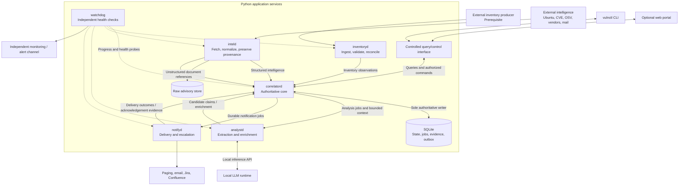
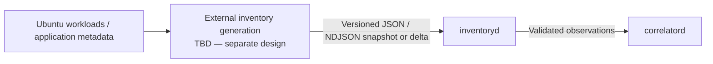
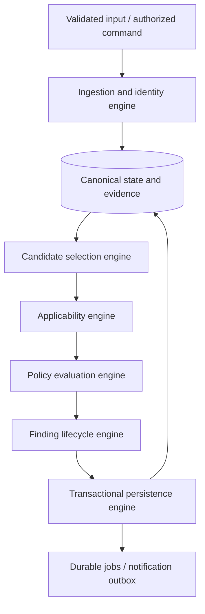
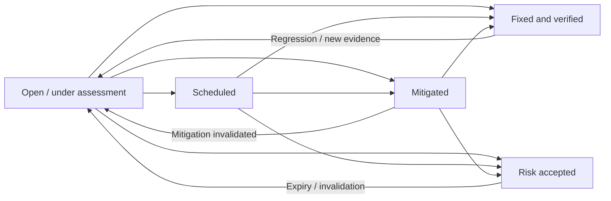
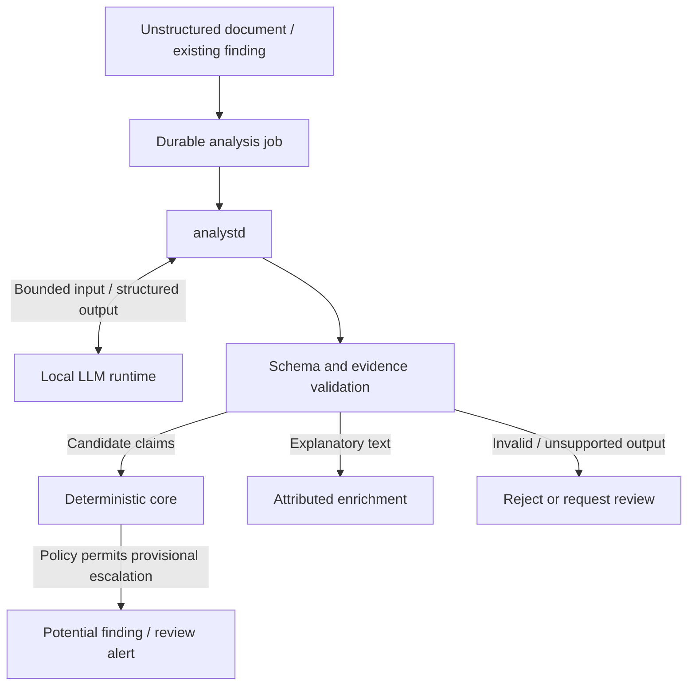
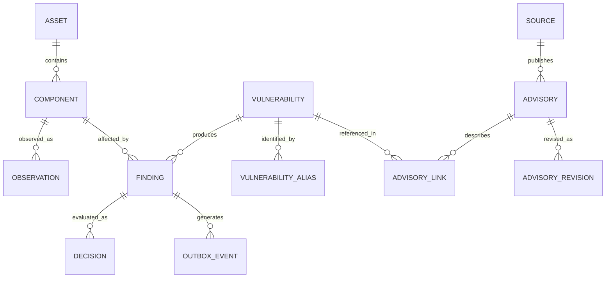
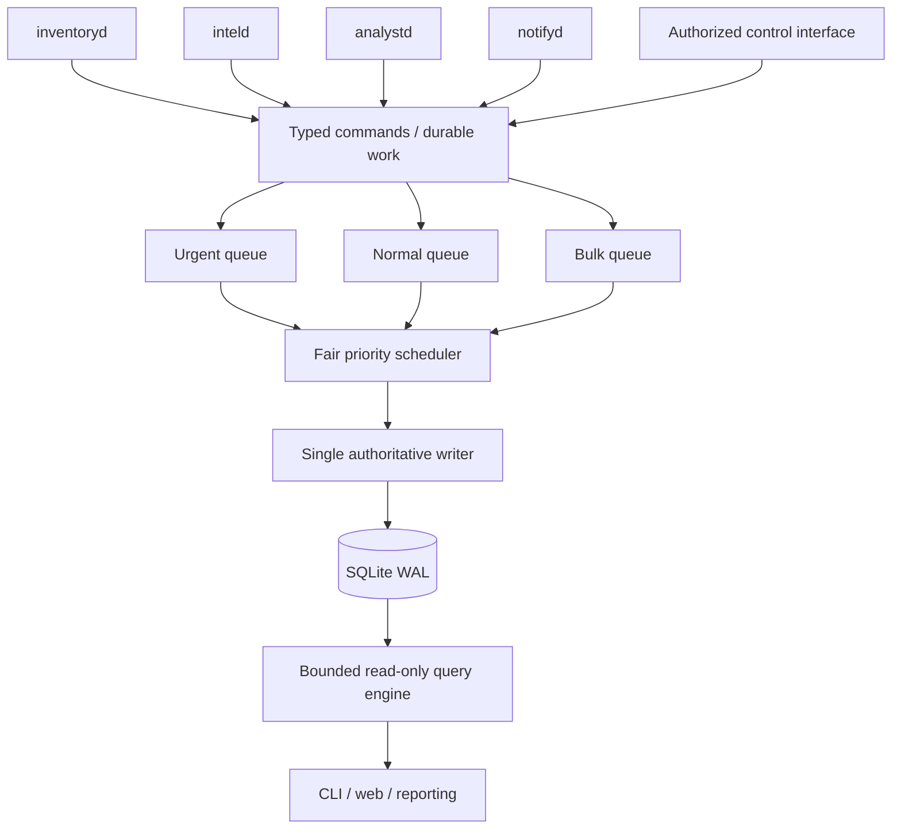
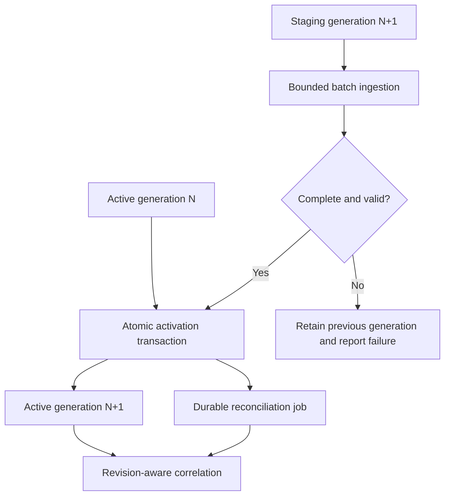
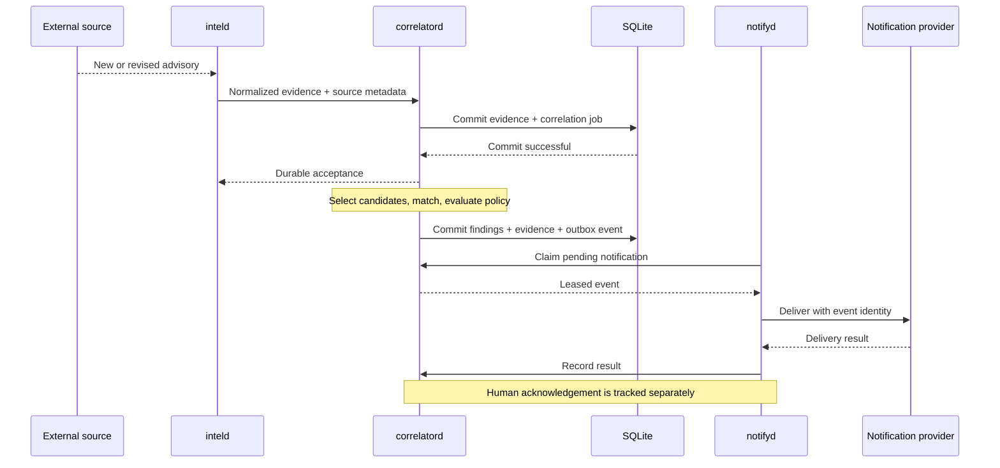
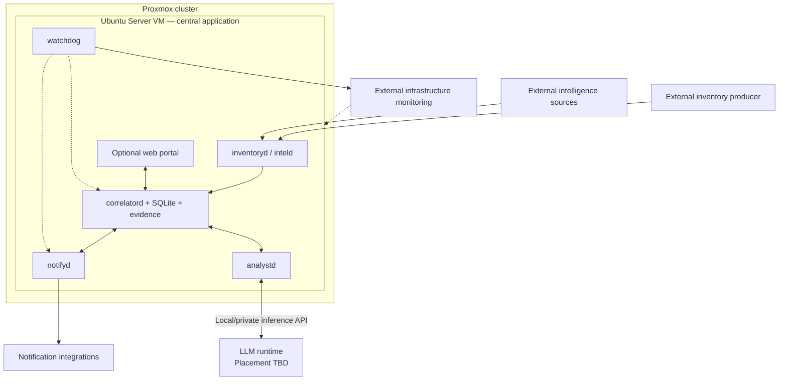

# Vulnerability Intelligence and Correlation Engine

**Architecture proposal · v0.2 · 26 November 2026**  
**Status:** Draft for engineering review  
**Working name:** `vulnmon`

### Revision history

| Version | Date | Changes |
|---|---|---|
| 0.1 | 2026-11-25 | Initial Python-first architecture |
| 0.2 | 2026-11-26 | Addressing SQLite limitations: single writer, bounded priority-aware transactions, atomic inventory generations, WAL health, durability and migration criteria |

## 1. Purpose

The system continuously correlates an organization's observed software inventory with external vulnerability intelligence. It identifies applicable or potentially applicable vulnerabilities, evaluates their priority according to explicit policy, maintains the lifecycle of findings, and reliably delivers actionable notifications.

It is intended to provide the technical foundation for the *CVE Monitoring & Response Process*, including emergency detection, daily reconciliation, evidence-based decisions and historical replay. It is not an autonomous patching or incident-response system.

The architecture is based on three principles:

> Deterministic core. Extensible periphery. Probabilistic intelligence.

Application services, engines and management tooling are implemented in Python. Existing native system utilities, libraries and the selected local LLM inference runtime may be used as dependencies; no custom C implementation is required for the initial architecture.

## 2. Scope and assumptions

| Area | Initial scope |
|---|---|
| Infrastructure | Ubuntu Server workloads, predominantly hosted on a Proxmox cluster |
| Application components | OS packages, runtimes, external libraries, platforms and database systems represented in the inventory |
| Inventory generation | External prerequisite; collection mechanism is outside this architecture |
| Vulnerability intelligence | Structured feeds, vendor bulletins, mailing lists and selected security publications |
| Processing | Centralized, incremental, deterministic correlation and policy evaluation |
| AI | Locally hosted LLM for unstructured intelligence and explanatory analysis |
| Deployment | Single Ubuntu Server VM on existing infrastructure, initially |
| Persistence | SQLite and a local content-addressed document store |
| Interfaces | Headless operation, CLI, optional web portal and external notification integrations |

The Ubuntu guest fleet is the initial target. Proxmox hypervisor hosts and cluster management components require an explicit inventory scope decision; their presence must not imply that they are Ubuntu guests or that they are already monitored.

Automated patching, endpoint detection, compromise investigation, inventory discovery, asset ownership discovery and production configuration changes are outside the initial scope. The system may report relevant evidence or recommended actions but does not perform them.

## 3. Architectural principles

- **UNIX composition:** small components, inspectable data formats, explicit interfaces and useful standalone command-line operations.
- **Python-first:** prefer standard-library facilities and explicit adapters over frameworks; introduce dependencies only for demonstrated requirements or correctness.
- **Single authority:** authoritative findings, policy decisions and state transitions are owned by the correlation core. All authoritative writes are serialized through its persistence engine; emergency work takes priority over routine bulk activity without starving it.
- **Evidence before conclusions:** every assessment records its inputs, source provenance and rule versions. Unknown is a valid outcome; missing evidence never means unaffected.
- **Durability before acknowledgement:** work is durably accepted before acknowledging it. Services may restart without silently losing events.
- **AI independence:** structured-intelligence matching, policy decisions and emergency notifications do not depend on the LLM.
- **Headless by design:** neither a browser nor a web application is needed for normal operation.
- **Fail visibly:** expose source outages, stale inventory, stalled processing, failed deliveries and incomplete coverage.

Logical modules are not necessarily independent daemons. A component warrants a separate process when its privileges, failure characteristics, workload or lifecycle justify it. The architecture does not require microservices, a message broker or container orchestration.

## 4. System overview



All arrows indicate logical relationships, not a requirement for a dedicated socket or network API per arrow. In the initial deployment, the control interface may be part of `correlatord`, and the watchdog may be a periodic Python command. Internal engines communicate through Python calls; process boundaries use versioned messages.

### 4.1 Component catalogue

| Component | Kind | Primary responsibility | Execution pattern |
|---|---|---|---|
| `inventoryd` | Input service | Accept and reconcile externally supplied inventory | Snapshot / event driven |
| `inteld` | Input service | Acquire and normalize external vulnerability intelligence | Scheduled polling / event driven |
| `correlatord` | Core service | Correlate evidence, evaluate policy and manage authoritative state | Event driven + periodic reconciliation |
| `notifyd` | Output service | Route, deliver, retry and escalate notifications | Durable job processing |
| `analystd` | Optional analysis service | Extract candidate intelligence and generate explanations | Asynchronous job processing |
| `watchdog` | Independent utility/service | Verify progress and monitoring coverage | Periodic |
| `vulnctl` | CLI | Query, inspect, ingest, replay and administer | On demand |
| `webui` | Optional separate application | Human-readable reports and authorized management | On demand |

The service names are provisional. The LLM runtime is an external dependency of `analystd`, not a second decision engine.

## 5. Inventory input contract — external prerequisite

The mechanism for discovering, collecting and delivering infrastructure inventory will be specified separately. This architecture begins at the point where inventory data is submitted to `inventoryd`.



The minimum input contract must describe:

| Data group | Required information |
|---|---|
| Asset identity | Stable asset ID, environment, OS release and architecture |
| Component identity | Ecosystem, name, exact version, origin and installation method; source package where relevant |
| Deployment identity | Service/workload association and artifact or image digest where applicable |
| Observation metadata | Snapshot ID, observation timestamp, producer identity, scope and completeness |
| Context | Exposure, owner, business criticality and relevant runtime configuration where available |

Missing context is represented explicitly as unknown. For Ubuntu packages, the complete distribution package version, Ubuntu release and package origin are critical inputs; a generic upstream version is not sufficient to evaluate a backported fix.

The producer must support stable identities, authenticated submission and a defined freshness target. Full snapshots must identify their covered scope and whether collection succeeded. A partial or failed snapshot must not be interpreted as removal of previously observed components. Delta submissions must support ordering or revision checks and periodic full reconciliation.

**Open prerequisite:** collection tooling, Proxmox integration (if desired), transport from producers, coverage guarantees, refresh cadence, runtime evidence and ownership metadata are to be agreed separately. The application reports unmet inventory prerequisites rather than inventing missing facts.

## 6. Input services

### 6.1 `inventoryd` — internal state ingestion

`inventoryd` receives inventory observations and validates their schema, producer identity, size, timestamps and scope. It normalizes component identifiers, handles duplicate submissions and translates producer-specific representations into the canonical inventory contract.

The core stages full snapshots in bounded batches and activates only complete, validated generations atomically (Section 9.6). Deltas follow explicit revision checks. Material changes generate durable inventory reconciliation work; repeated identical snapshots update freshness without creating duplicate findings. Historical observations remain available according to the retention policy.

`inventoryd` does not scan hosts, install agents, determine vulnerability priority, write authoritative findings or modify infrastructure.

### 6.2 `inteld` — vulnerability intelligence acquisition

`inteld` schedules source adapters, fetches external material, validates and normalizes structured advisories, archives original documents and submits evidence to the core. Sources have independent schedules, checkpoints, timeout policies and health states.

| Source class | Initial candidates | Purpose |
|---|---|---|
| Ubuntu security intelligence | Ubuntu Security Notices, Ubuntu CVE data / machine-readable security data | Exact distribution and release-specific applicability and fixes |
| General structured intelligence | CVE List V5, OSV, GitHub Advisory Database | Cross-ecosystem vulnerabilities and aliases |
| Exploitation intelligence | CISA KEV, FIRST EPSS | Exploitation signals and prioritization context |
| Direct vendor intelligence | PHP, database and other relevant product advisories | Product-specific details, emergency notices and mitigations |
| Unstructured intelligence | Vendor mailing lists, RSS, selected research publications | Early warnings, pre-announcements and contextual evidence |

This is a candidate source list, not an integration commitment. Exact endpoints, schemas, licensing, cadence and failure semantics will be validated during implementation.

Adapters implement a common fetch/parse/normalize contract. They preserve source-specific claims rather than prematurely merging contradictory statements into a single asserted fact. Raw material carries source identity, retrieval time, publication time where known, content hash and parser version.

A source checkpoint advances only after the relevant material has been durably accepted. Repeated downloads or retries must be safe. Large or untrusted parsers should run in bounded, isolated workers where justified. A source failure must not invalidate previously acquired evidence or silently stop other sources.

## 7. `correlatord` — deterministic decision core

`correlatord` is the application’s authoritative service. It owns canonical inventory and intelligence state, findings, policy decisions, lifecycle transitions and the persistent job/outbox mechanisms. Internally, it is divided into engines with explicit interfaces rather than multiple network services.



| Engine | Responsibility |
|---|---|
| Ingestion and identity | Validate contracts, resolve canonical identifiers and aliases, preserve revisions, record observations and enqueue affected work |
| Candidate selection | Use indexed identities to identify relevant components and advisories without exhaustive cross-product scans |
| Applicability | Evaluate ecosystem-specific versions, distribution status, product/configuration conditions and conflicting evidence |
| Policy evaluation | Apply versioned, explicit organizational rules to applicability, impact, exposure, exploitation signals and criticality |
| Finding lifecycle | Create, update, reopen or close findings; handle overrides, mitigation, verification and expiring risk acceptance |
| Persistence and event management | Own the single writer, prioritize and bound transactions, commit findings/evidence/jobs atomically, and expose controlled access to state |

### 7.1 Identity and applicability

A vulnerability has a stable internal identity and may acquire CVE, GHSA or vendor aliases later. Advisories are evidence records and may reference multiple vulnerabilities; related vulnerabilities need not be aliases of one another. A finding links a vulnerability to a stable component instance within an asset or workload.

The applicability engine must understand package ecosystems, not simply compare version strings. Ubuntu security data takes precedence for matching Ubuntu-provided builds when it addresses the exact release and package provenance. Upstream or application ecosystem evidence is used where appropriate. Unsupported origins, unresolved aliases or conflicts produce an explicit unknown state.

| Applicability result | Meaning |
|---|---|
| `affected` | Sufficient evidence establishes vulnerability applicability |
| `not_affected` | Positive evidence establishes non-applicability |
| `fixed` | Evidence establishes that the observed build contains the applicable fix |
| `unknown` | Evidence is missing, ambiguous, stale, unsupported or conflicting |

A fixed build assessment alone is not a verified remediation: running processes, deployed replicas and inventory completeness may require additional evidence. Applicability, remediation lifecycle and notification delivery are distinct dimensions.

### 7.2 Evaluation and lifecycle

The policy engine evaluates normalized evidence through versioned deterministic rules. P0–P3 priorities, emergency pre-announcement handling, SLA clocks and exception conditions derive from the governing response process. Exact policy thresholds and authority are configured separately and must not be hard-coded into adapters.

Reevaluation is triggered by new or changed advisories, inventory changes, exploitation signals, policy revisions, risk expiry and periodic reconciliation. Findings retain their identity across retries and updates; rollback or new evidence may reopen them. Authorized human overrides retain their reason, actor, timestamp and expiry. They do not overwrite the original automated decision.



This is a conceptual lifecycle, not a mandatory sequential workflow. Accepted risk remains visible as residual exposure; mitigated does not mean fixed. A no-longer-present component or a corrected non-applicable assessment requires an explicit disposition and evidence rather than silently deleting the finding.

## 8. Output and analysis services

### 8.1 `notifyd` — reliable notification delivery

`notifyd` consumes durable jobs emitted by the core. It applies routing configuration, renders messages, invokes channel adapters and returns delivery outcomes to the core. Supported channels may include paging, email, Jira, Confluence, webhooks and syslog.

It handles retry with bounded backoff, delivery deadlines, channel-specific idempotency keys and escalation. Acknowledgement from an external API is distinct from acknowledgement by a human responder. Unacknowledged emergency notifications escalate according to policy. Permanently failed or exhausted jobs remain visible and trigger independent monitoring.

It does not decide whether a vulnerability is applicable, alter its severity or mark remediation complete. Jira and Confluence are integrations, not independent authorities over the core's technical state. Synchronizing authorized workflow changes back into the core is an explicit integration contract.

### 8.2 `analystd` — local LLM integration

`analystd` is a Python service communicating with a separately hosted local inference runtime. The model, runtime and hardware are deployment choices; no custom model training is assumed.

It has two distinct workloads:

- **Intelligence extraction:** process unstructured announcements and publications to identify candidate affected products, conditions, dates, impact and mitigation claims, including signals without a CVE identifier.
- **Contextual enrichment:** generate evidence-linked explanations, potential attack-path descriptions, mitigation considerations and human-readable summaries for existing findings.



Model outputs are untrusted candidate evidence. Schema validation establishes format, not truth. Claims retain document references and supporting excerpts where possible. They may trigger conservative investigation through policy but cannot suppress a finding, assert definitive non-applicability, approve risk or declare a fix. The core or an authorized reviewer must establish authoritative conclusions.

`analystd` has no production credentials, shell execution capability, direct authoritative database writes or arbitrary external network access. It receives only necessary context. Retrieved content is treated as potentially hostile, including prompt injection.

If inference is unavailable, structured intelligence and notifications continue. Unstructured early-warning coverage may be degraded; this is observable and covered by independent vendor subscriptions or deterministic keyword/source-based alerts for designated critical components.

## 9. Persistent state and communication

### 9.1 Logical data model



The diagram is a conceptual entity model, not a physical database schema. The eventual schema also requires policy revisions, ingestion receipts, processing jobs, source checkpoints, delivery attempts, risk exceptions, audit records and references to raw evidence.

Separate stable component identity from observed version. A package upgrade or rollback should normally change the observation of an existing component, not destroy the finding's identity. Where identical packages occur multiple times, instance identity must include the relevant workload or installation scope.

### 9.2 Storage model

SQLite is the initial authoritative relational store. `correlatord` is its sole application writer. Other services obtain work and submit outcomes through the core's interface rather than directly modifying shared database tables. The core may use separate read-only connections internally. Sections 9.5–9.8 define the concurrency, generation, durability and capacity requirements.

Original advisory bodies may be kept in a content-addressed filesystem store referenced by the database. Store an immutable blob durably before committing its reference; a crash may leave an unreferenced blob, which can be garbage-collected later. Missing or corrupt referenced material is an observable integrity failure.

Historical replay requires retaining both what was observed and when it became known to the system. Retention periods, backup schedules and restore objectives remain deployment decisions. Backups must include the database, referenced evidence and versioned configuration in a consistent recoverable set; use SQLite-aware backup procedures rather than copying an active database file alone.

### 9.3 Process interfaces

Use local UNIX domain sockets with filesystem permissions for initial interprocess communication. JSON messages are framed and versioned; bulk import/export uses JSON or NDJSON. Remote submissions or a separately deployed portal require an authenticated transport or gateway, defined during implementation.

Each operation has bounded payload sizes, explicit success/failure responses, request IDs and documented retry semantics. An acknowledgement of successful ingestion means the core has durably persisted the submitted data and any required processing work; it does not mean every downstream finding has already been evaluated.

### 9.4 Durable jobs and transactional outbox

Input acceptance and downstream processing are separate durable steps. The core commits incoming observations or intelligence alongside the correlation work required to process them. Correlation workers evaluate bounded batches; completed findings, evidence and outgoing events are committed atomically. A failed batch remains recoverable and must not be acknowledged as completed.

Notification and analysis jobs use the same durable work model. Consumers lease or claim work with an expiry, report outcomes through the core and may retry after interruption. At-least-once processing requires stable identities and idempotent operations. External notification APIs may still produce duplicates when delivery succeeds but acknowledgement is lost.

No separate broker, distributed cache or search platform is required initially. SQLite capacity, transaction contention and queue latency must be measured before deciding otherwise.

### 9.5 SQLite concurrency and transaction scheduling

SQLite remains the initial storage engine. WAL mode permits concurrent readers and one active write transaction per database file. Concurrent producers are expected, particularly during morning reconciliation, initial intelligence imports, emergency advisories and reporting. The application must schedule writes explicitly instead of relying on SQLite lock arbitration to express operational urgency.

| ID | Architectural requirement |
|---|---|
| DB-01 | Exactly one authoritative application writer, owned by the persistence engine inside `correlatord` |
| DB-02 | Bounded write transactions, priority-aware scheduling, fairness and observable backpressure |
| DB-03 | Generation-based atomic activation of complete inventory snapshots; revision-aware evaluation |
| DB-04 | Bounded read transactions, WAL/checkpoint health monitoring and independent alerting |
| DB-05 | Explicit persistence interfaces, independent of SQLite-specific details at the domain layer |



The scheduler is an internal Python module, not a new network service. Only its designated execution context owns the read-write connection. All mutations, including leases, acknowledgements, analysis results and administrative commands, pass through typed operations; arbitrary SQL is not accepted through IPC. Separate read-only connections may be owned by the controlled query engine and correlation workers.

| Work class | Typical operations |
|---|---|
| Urgent | Credible emergency advisory intake, provisional assessment, P0 finding/outbox commits, emergency notification claims and acknowledgements |
| Normal | Routine advisory updates, lifecycle transitions, policy changes and analysis results |
| Bulk | Snapshot staging, historical imports, reconciliation and retention maintenance |

Urgency must be derived from trusted source/context rules and validated commands, not an arbitrary priority supplied by an untrusted producer. Potential P0 intelligence must be eligible for urgent processing before applicability is resolved. Priority applies to ingestion, correlation and notification dispatch, not just commits. Reserve capacity for urgent requests and use bounded queues, quotas and explicit retry/backpressure for overload. Preserve causality between dependent operations and ensure bulk work makes progress through fairness/aging. Accepted durable jobs remain recoverable; uncommitted in-memory requests are not acknowledged as durably accepted. Producers must retry with stable request identities, or retain a durable local spool where their input cannot be reproduced.

Compute matching results, fetch external data, parse documents and perform LLM/network operations outside write transactions. Commit only validated state changes and required jobs. Avoid holding a transaction while waiting for a worker, network response or user. A running SQLite transaction cannot be preempted by the scheduler; short transactions reduce, but do not strictly bound, emergency waiting time.

| Parameter | Initial experimental target |
|---|---|
| Bulk batch size | 500–2,000 records, adaptive to workload |
| Bulk transaction duration | ≤ 100 ms desired |
| Routine transaction duration | ≤ 50 ms desired |
| Urgent scheduler dispatch latency | ≤ 250 ms desired, measured separately from correlation and delivery |
| SQLite busy timeout | 5 s initial upper wait setting per relevant connection; investigate unexpected contention |

These are starting points for tests, not hard real-time guarantees or measured capacities. Storage stalls, lock acquisition, checkpoints and competing work may exceed them. A busy timeout is not a transaction execution deadline. The independent watchdog must detect prolonged queue age, not assume the scheduler meets its targets.

### 9.6 Inventory generations and revision consistency

Bulk import must not expose partial snapshots as authoritative inventory. Stage full snapshots in bounded transactions under a generation scoped to the producer and its declared coverage. Use a stable generation identifier and validate completeness, revision ordering, expected scope and integrity before activation. The previous complete generation remains active during staging; its age and any in-progress/failed import remain visible.



Activation atomically switches the active-generation reference and creates a durable reconciliation job in the same database transaction. Material differences may be computed in bounded work outside the activation transaction; the job records the old and new generation and remains recoverable. Acknowledgement of staging is distinct from successful activation. A failed or incomplete snapshot cannot imply deletion of previously observed components. Deltas use explicit base revisions and idempotent ordering; incompatible or out-of-order deltas require retry/reconciliation rather than silent application.

Correlation jobs carry the inventory, advisory and policy revisions used during evaluation. The core verifies relevant revisions at commit time; stale results cannot overwrite newer decisions or justify closure. Requeue affected work when necessary. While a generation is staging or reconciliation is pending, expose freshness and coverage uncertainty; credible emergency signals must still be assessed against the last complete inventory and any positively observed new exposure, conservatively. Do not infer non-applicability from incomplete observations. Retain previous generations as needed for evidence, replay and pending jobs; reclaim them in bounded maintenance batches under the retention policy.

### 9.7 SQLite durability, readers and storage

Initial configuration for the authoritative writer and relevant connections:

```sql
PRAGMA journal_mode = WAL;
PRAGMA synchronous = FULL;
PRAGMA foreign_keys = ON;
PRAGMA busy_timeout = 5000;
```

Set and verify WAL mode during database initialization. Configure connection-scoped settings on each relevant connection. Read-only consumers use read-only connections through the controlled query interface; no unrestricted direct portal access is allowed. Keep query transactions short, paginate large results, and release database snapshots before rendering or streaming slow reports. If a report requires a consistent historical view that would pin the WAL for too long, use a SQLite-aware backup or an isolated reporting snapshot. Monitor WAL size, checkpoint progress and free disk space; start with SQLite's default automatic checkpoint behavior and change it only based on measurements. Maintenance/checkpoint coordination belongs to the persistence layer.

`FULL` synchronous mode prioritizes committed-event durability over maximum throughput, subject to correct filesystem and storage flush behavior. Place SQLite on a filesystem local to the Ubuntu VM. A Proxmox virtual block device backed by local storage, Ceph or NFS-backed VM storage is distinct from multiple hosts opening the same SQLite file through a network filesystem; the latter is not supported for this WAL deployment. Benchmark commit and synchronization latency on the intended VM/storage configuration and validate recovery under interruption. Do not treat Proxmox snapshots alone as the application backup policy.

Verify the SQLite library actually loaded by the deployed Python interpreter and the Ubuntu package's security/backport status. Include the application's own dependencies in vulnerability monitoring. In particular, check that the runtime includes the upstream WAL-reset corruption fix (SQLite 3.51.3 or an applicable backport); do not infer patch status solely from an upstream version string. This is a deployment verification item, not a claim about the currently installed Ubuntu packages.

```sh
python3 -c 'import sqlite3; print(sqlite3.sqlite_version)'
dpkg-query -W libsqlite3-0
apt-cache policy libsqlite3-0
```

References: [SQLite WAL](https://sqlite.org/wal.html), [SQLite PRAGMA documentation](https://sqlite.org/pragma.html), [SQLite change history](https://sqlite.org/changes.html).

### 9.8 Observability, capacity and migration criteria

| Metric | Purpose |
|---|---|
| Queue depth and oldest pending age by class | Detect overload, starvation and urgent backlog |
| P95/P99 transaction duration and scheduler wait | Detect contention and persistence latency |
| P0 intake-to-finding/outbox and delivery latency | Verify the fast lane under competing load |
| Bulk ingest throughput and generation activation lag | Detect stale inventory and reconciliation pressure |
| Read transaction age, WAL size and checkpoint progress | Detect pinned snapshots and checkpoint starvation |
| `SQLITE_BUSY` / `SQLITE_LOCKED` and failed commits | Detect unexpected contention or implementation defects |
| Storage synchronization latency, free disk and recovery | Detect VM/storage bottlenecks and durability risks |

Test realistic simultaneous inventory refresh, intelligence synchronization, correlation, notification acknowledgement and reporting. Include cold initialization, sustained bursts, a P0 arriving during bulk ingestion, interrupted snapshot imports, stalled readers, storage exhaustion and crash/restart recovery. Measure on the actual target VM with representative data, including indexes, evidence retention and synchronous commit settings. No asset-count threshold alone determines SQLite suitability.

Keep a small explicit persistence interface for domain operations and transaction boundaries, implemented initially using Python `sqlite3` and SQL migrations. Do not add an ORM or generic database framework solely to anticipate a migration. SQL/schema adaptation and migration testing would still be necessary. Keep findings, decisions and their required outbox events in one transactional domain.

| Observed requirement or condition | Architectural response |
|---|---|
| Bounded single-node workload meets targets | Retain SQLite |
| Growing imports or millions of component instances | Benchmark; optimize indexes, revision grouping, batches and retention before deciding |
| Sustained queue saturation or unacceptable emergency latency | Profile and correct scheduling/storage bottlenecks; evaluate PostgreSQL if targets remain unmet |
| Heavy historical analytics | Use isolated reporting snapshots or evaluate a separate reporting store |
| Multiple active writers across machines, shared central database or database replication/failover | Strong case for a client/server database such as PostgreSQL; separate availability design required |

Splitting inventory, intelligence and operational state into multiple SQLite databases is a possible intermediate design, not the baseline. Each database has an independent write lock, but cross-file foreign keys are unavailable and WAL-mode attached database commits are not collectively crash-atomic. Such a split would require explicit revision coordination, replay/recovery and consistent backup procedures. Avoid it until justified by measurements; never split a finding from its transactional notification outbox.

## 10. Principal execution flows

### 10.1 New structured advisory



Emergency findings bypass daily digest scheduling. Notification delivery does not wait for LLM enrichment; an explanation can be appended later.

### 10.2 Inventory change and reconciliation

A newly accepted full snapshot is staged and validated before atomic generation activation; a valid delta updates its declared scope. Durable reconciliation identifies changed component builds, removed instances, stale observations and changed exposure context. The core matches affected identities against already known intelligence. This catches vulnerable new deployments and rollback-induced regressions without waiting for another advisory.

Daily full reconciliation provides a second path for detecting missed incremental work, recovering from inconsistent state and applying changed evidence. It must not block urgent processing for extended periods. The core should prioritize emergency work and use bounded reconciliation batches.

### 10.3 Early warning without a CVE identifier

A trusted vendor pre-announcement may enter the core directly through deterministic source rules or indirectly as candidate evidence extracted by `analystd`. A provisional internal vulnerability identity is created, potentially relevant inventory is identified and policy determines whether emergency assessment is warranted. A later CVE record is linked when evidence supports equivalence; it does not automatically create a second remediation obligation.

## 11. Management and presentation layer

`vulnctl` is the primary operational interface and should precede web development. Suggested capabilities:

```text
vulnctl status
vulnctl sources
vulnctl inventory --stale
vulnctl findings --priority P0
vulnctl explain <finding-id>
vulnctl history <finding-id>
vulnctl replay --from <timestamp>
vulnctl health
```

The web portal is a separate, optional application using the same controlled query and management interface. For the Python-first design, a small server-rendered application is the default candidate; the specific framework is deferred. It should display findings, affected assets, evidence, history, SLA status, inventory coverage, source health and notification delivery. Management actions require authorization and audit records.

Neither CLI nor portal independently evaluates vulnerability applicability or writes directly to the authoritative database. Historical replay should run against isolated state by default and must not send real emergency notifications unless explicitly enabled for a controlled drill.

## 12. Deployment, privileges and operational health



An initial single-node VM minimizes infrastructure and operating complexity. Systemd is the proposed process supervisor on Ubuntu; scheduled utilities may use timers. Each long-running service runs under a dedicated unprivileged identity where feasible. The local LLM may run on the same VM or on separate infrastructure, depending on resource requirements and isolation. Co-located inference must not starve the deterministic core.

| Component | Intended permissions / network access |
|---|---|
| `inventoryd` | Authenticated inventory intake; submit observations to core |
| `inteld` | Controlled outbound access to configured intelligence sources; raw evidence storage |
| `correlatord` | Authoritative state and policy; local IPC; no general external network access required |
| `notifyd` | Controlled outbound access to configured integration endpoints; limited integration credentials |
| `analystd` | Bounded evidence and private inference endpoint; no production or notification credentials |
| `webui` / `vulnctl` | Authorized query and management operations, no unrestricted database writes |
| `watchdog` | Read-only health/progress probes and independent alerting path |

Secrets are kept outside source control and raw advisory data. Input size limits, parser timeouts, controlled redirects, TLS verification, filesystem permissions and least-privilege service identities are baseline requirements. Local IPC authorization must distinguish service identities and administrative users; message fields alone do not establish identity.

### 12.1 Failure model

| Failure | Expected behaviour |
|---|---|
| Inventory missing or stale | Preserve last known observations; mark freshness/coverage degraded; avoid false non-applicability or closure |
| Individual intelligence source unavailable | Continue other sources; preserve prior evidence; report loss of coverage |
| Correlation process interrupted | Restart and resume durable jobs; do not discard pending work |
| Database unavailable or storage exhausted | Reject uncommitted ingestion, preserve upstream retry ability, raise independent alert |
| Bulk work delays emergency processing | Prioritize urgent work at transaction boundaries, apply backpressure and report queue age |
| Snapshot import interrupted | Keep the last complete generation active, resume or discard staging explicitly, report degraded freshness |
| Long reader or checkpoint stall | Bound or cancel reporting work, monitor WAL/disk growth, raise independent alert |
| Notification provider unavailable | Retry or escalate via alternative configured route; retain pending/failed events |
| LLM unavailable | Deterministic processing continues; semantic extraction/enrichment coverage visibly degrades |
| Web portal unavailable | Headless processing and CLI remain available |
| Entire VM or cluster unavailable | External monitoring alerts independently; recovery follows documented backup/restore procedure |

The watchdog monitors progress, not merely process liveness: last successful source collection, inventory freshness, oldest pending emergency job, correlation progress, last successful digest and delivery health, write queue age by priority, transaction latency, WAL size and checkpoint progress. It must not rely solely on `notifyd` for emergency alerts. External monitoring is necessary because a local watchdog cannot detect and report its own host's complete loss reliably.

A single VM is a single application failure domain. Proxmox hosting does not by itself provide application-level high availability. Recovery time and data-loss objectives must be accepted explicitly before production adoption.

## 13. Initial implementation stack

| Layer | Proposed technology |
|---|---|
| Application services and engines | Python 3, supported version selected during implementation |
| Domain model | `dataclasses`, enums, typed interfaces and explicit boundary validation |
| Database | Python `sqlite3`, WAL, explicit persistence interface, single-writer scheduler and versioned SQL migrations |
| IPC and serialization | `socket` / `asyncio` as justified; JSON / NDJSON |
| External integrations | Standard-library HTTP, mail and TLS initially; specialized libraries as justified |
| Configuration | TOML (`tomllib`) or another agreed inspectable format |
| Supervision | Systemd services and timers |
| Logging | Structured logs to stderr / journal; correlation and event IDs |
| LLM | Existing local inference runtime, private API; model selection deferred |
| Web | Optional Python server-rendered application; framework deferred |
| Testing | Standard-library tests, fixture datasets, replay and fault injection |

Prefer existing authoritative version-comparison implementations over custom comparators. Ubuntu package versions can initially be checked against the platform's native `dpkg` semantics; avoid invoking a subprocess per comparison at scale without measuring the overhead. Application dependency ecosystems require their own matching semantics. Dependencies that implement these correctly may be justified even when a standard-library alternative is unavailable.

Possible additional dependencies include `packaging` for Python version semantics, `jsonschema` for contract validation, a maintained HTTP client if necessary and static type checking in CI. None is an unconditional commitment. Pin and audit selected dependencies; keep parser and adapter dependencies isolated where practical.

## 14. Proposed repository layout

```text
vulnmon/
├── ARCHITECTURE.md
├── README.md
├── pyproject.toml
├── contracts/
│   ├── inventory.schema.json
│   ├── advisory.schema.json
│   ├── finding.schema.json
│   ├── event.schema.json
│   └── protocol.md
├── src/vulnmon/
│   ├── common/           # Shared types and protocol primitives
│   ├── inventoryd/       # Ingestion, validation, normalization
│   ├── inteld/           # Source adapters, scheduling, checkpoints
│   ├── correlatord/
│   │   ├── identity.py
│   │   ├── matchers/
│   │   ├── policy.py
│   │   ├── lifecycle.py
│   │   ├── persistence/   # Domain operations, writer scheduling
│   │   │   ├── interface.py
│   │   │   ├── sqlite.py
│   │   │   └── scheduler.py
│   │   └── outbox.py
│   ├── notifyd/          # Routing, delivery, retry, channel adapters
│   ├── analystd/         # Extraction, enrichment, validation
│   ├── watchdog/         # Independent progress checks
│   └── cli/              # vulnctl
├── webui/                # Optional separate application
├── sql/
│   ├── schema.sql
│   └── migrations/
├── config/
│   ├── sources.toml
│   ├── policy.toml
│   └── notifications.toml
├── tests/
│   ├── unit/
│   ├── integration/
│   ├── replay/
│   ├── fault_injection/
│   ├── performance/
│   └── fixtures/
└── contrib/
    └── systemd/
```

This layout describes ownership and architectural boundaries, not a requirement to create every module immediately. Inventory generation has no implementation directory here because it is a separate prerequisite.

## 15. Implementation sequence and validation

| Stage | Deliverable | Acceptance criterion |
|---|---|---|
| 1 — Contracts and storage | Fixture-based inventory/advisory ingestion, identity model, SQLite | Inputs are validated, repeatable and durably accepted; incomplete inventory remains visible |
| 2 — Correlation | Ubuntu package matching, selected application ecosystem, deterministic policy and finding lifecycle | Correct handling of backports, unknown applicability, updates, duplicate records and rollbacks |
| 3 — Continuous operation | Polling adapters, durable processing, notification delivery, health monitoring | Emergency findings survive restart and are delivered without the LLM or portal |
| 4 — Semantic intelligence | Local inference, extraction and attributed summaries | Pre-CVE candidate warnings are useful; unsupported claims cannot suppress authoritative findings |
| 5 — Management | CLI completion, optional portal, operational integrations and dashboards | Queryable evidence, controlled management operations and auditable history |

The first useful milestone is intentionally headless: ingest fixture data, run correlation, inspect findings and reproduce decisions. The actual inventory generator is not required to develop and test this milestone.

Validation must cover version ordering and distribution backports, alias reconciliation, partial and out-of-order snapshots, missing scores, conflicting evidence, transaction interruption, duplicate events, notification failures, expired risk exceptions, vulnerable rollbacks and LLM outages. The PHP2Shell timeline from the governing process is a proposed historical replay fixture. Historical tests must reveal evidence in the order it was available, not use hindsight from finalized records.

Performance should be measured using representative asset counts, distinct software builds and realistic advisory updates. Optimize candidate selection, grouping, database transactions and incremental evaluation before considering native code or more infrastructure. The concurrent workload and failure tests in Section 9.8 are required before production adoption. No performance benchmark or capacity guarantee is implied by this architecture.

## 16. Architectural decisions and open questions

| Decision | Status |
|---|---|
| Python for all custom application components | Agreed |
| Ubuntu Server as initial infrastructure target; predominantly Proxmox-hosted | Agreed |
| Inventory generation outside application scope | Agreed |
| Deterministic decision core and non-authoritative local LLM | Retained from prior design |
| Single-node deployment, SQLite, local IPC, systemd | Proposed baseline; validate availability and workload requirements |
| Central core as sole authoritative writer; WAL and priority-aware bounded transactions | v0.2 architecture requirement (DB-01/02) |
| Atomic inventory activation and revision-aware results | v0.2 architecture requirement (DB-03) |
| Bounded reads, WAL health and explicit persistence interface | v0.2 architecture requirement (DB-04/05) |
| SQLite capacity, batch sizing and Proxmox storage latency | Open; benchmark on target VM |
| Multiple databases or PostgreSQL | Deferred; criteria in Section 9.8 |
| Optional separate web portal, Python by default | Proposed; implementation deferred |
| Exact service/process boundaries | Refine during prototype; avoid unnecessary resident processes |
| Inventory schema, collection producer, transport, coverage and cadence | Open prerequisite |
| Proxmox host/cluster components in inventory scope | Open |
| Exact intelligence feeds, rate limits and source precedence rules | Open; validate against deployed components |
| Policy thresholds, timers and escalation authorities | External policy dependency |
| LLM model, inference placement, hardware and evaluation dataset | Open |
| Expected assets, component builds, update rates and retention | Open; required for capacity planning |
| Backup, recovery, availability and integration requirements | Open |

The agreed language choice does not preclude using native libraries through established Python interfaces or replacing a component behind a stable contract later. However, introducing custom native code is not part of the initial plan and would require separate evidence-based justification.

---

### Design basis and limitations

This document consolidates the supplied *CVE Monitoring & Response Process* (25 November 2026), the preceding vulnerability-intelligence architecture proposal the subsequent language-selection discussion and the SQLite concurrency review (26 November 2026). It reflects the explicit decision to use Python and the newly stated Ubuntu/Proxmox environment. The proposed service boundaries, storage, deployment and interfaces are engineering recommendations, not verified properties of the organization's current infrastructure. This is a high-level design, not a formal specification, implementation, security audit or independent verification of incident chronology or external feed availability.
