# Vulnerability Intelligence and Correlation Engine

**Architecture proposal · v0.3 · 26 November 2026**  
**Status:** Revised draft for human engineering, security and operational approval  
**Working name:** `vulnmon`

## Revision history

| Version | Date | Changes |
|---|---|---|
| 0.1 | 2026-11-25 | Initial Python-first architecture |
| 0.2 | 2026-11-26 | Addressing SQLite limitations: single writer, bounded priority-aware transactions, atomic inventory generations, WAL health and migration criteria |
| 0.3 | 2026-11-26 | Peer-review revision: spool-oriented execution, exclusive database UID, provenance-aware matching, conservative crown-jewel escalation, explicit fix availability, threat model and measurable operational acceptance criteria |

## 1. Purpose and normative language

Vulnmon continuously correlates an organization's observed software inventory with external vulnerability intelligence. It identifies applicable or potentially applicable vulnerabilities, prioritizes them using explicit policy, maintains evidence-backed findings and reliably delivers actionable notifications. It provides the technical foundation for the *CVE Monitoring & Response Process* (25 November 2026), including emergency detection, daily reconciliation, verification support and historical replay. It is not an autonomous patching, endpoint detection or incident investigation system.

> Deterministic core. Extensible periphery. Probabilistic intelligence.

This revision incorporates the initial peer review of v0.2, the architectural response and the subsequent four clarification requirements. It separates permanent correctness guarantees from replaceable execution mechanisms. The architecture is a proposed design, not a statement that these capabilities have already been implemented or approved for production.

**MUST / MUST NOT** denote requirements necessary for correctness, security or the specified acceptance gate. **SHOULD / SHOULD NOT** denote recommended defaults from which a documented, justified exception is possible. **MAY** denotes optional choices. Requirements marked *pending approval* are proposed organizational commitments, not approved policy. Section 16 identifies their owners by role and the gates at which approval is needed; it does not assign people or calendar dates without authority.

## 2. Scope and release boundary

### 2.1 Target environment

| Area | Initial assumption |
|---|---|
| Infrastructure | Ubuntu Server workloads, predominantly Proxmox guests; one central Ubuntu VM |
| Implementation | Python custom application code; distribution-provided interpreter and libraries |
| Inventory | External producer with versioned input contract; reference producer required for operational acceptance |
| Persistence | One local SQLite database, immutable evidence store, durable filesystem spools |
| Execution | Short-lived commands under systemd timers; optional path activation |
| Management | Headless CLI and bounded exported reports |
| Intelligence | Structured Ubuntu and application advisories, KEV, deterministic crown-jewel source watches |

Proxmox hypervisor and cluster-management components are not implicitly included in Ubuntu guest coverage. If added, they require explicit Debian/Proxmox-specific inventory and intelligence adapters. Exact Ubuntu releases, PHP installation provenance, asset counts and existing inventory tooling must be confirmed rather than assumed.

### 2.2 Minimum operational release (v0)

Architecture version 0.3 is independent of software version. The existing fixture-driven prototype is an earlier development milestone, not the operational v0 release.

| In operational v0 | Explicitly deferred |
|---|---|
| Reference inventory producer for a representative real Ubuntu/PHP deployment | General-purpose inventory discovery, universal SBOM ingestion and broad platform support |
| Ubuntu USN/OSV candidate feed, Composer OSV, KEV and crown-jewel vendor/mailing-list watch | Broad CVE/GHSA/EPSS and vendor adapter catalogue unless needed for acceptance |
| Provenance-aware matching for actual deployed PHP builds; other unsupported origins visibly unknown | Comprehensive third-party package and image ecosystem support |
| Durable spool, exclusive core worker, SQLite, bounded reconciliation, outbox and receipts | Resident daemons, UNIX socket server, message broker, distributed processing |
| Deterministic early warning, P0 paging, acknowledgement and escalation; daily human-readable report | Local LLM, web portal, Jira/Confluence automation and inbound webhooks |
| Fix availability, lifecycle dispositions, conservative uncertainty handling and audited suppression | Generalized workflow engine and advanced analytics |
| Independent health heartbeat, replay, fault injection and restore test | Automated HA, PostgreSQL and cross-node active writers |

An approved human-managed incident process remains responsible for containment, patching, investigation and organizational risk decisions. For v0, risk-reducing technical overrides of P0 must either use an approved two-person mechanism or be disabled; deferring full administrative tooling must not create a unilateral suppression path. Manual Jira/Confluence reporting is acceptable for the initial technical milestone only if the process owner approves it before operational use.

## 3. Architectural invariants and decisions

| ID | Permanent guarantee |
|---|---|
| INV-01 | Unknown is a valid outcome; missing or stale evidence never means unaffected. |
| INV-02 | Applicability, fix availability, remediation and delivery are independent; a fixed build is not a verified remediation. |
| INV-03 | Incomplete inventory cannot imply component removal. Activation and revision checks protect current state. |
| INV-04 | The core owns technical state and authoritative writes; untrusted acquisition, delivery and inference cannot modify it. |
| INV-05 | Durability precedes acknowledgement; retries and replay preserve stable identity, evidence and pending work. |
| INV-06 | Emergency work has a bounded, observable path that does not depend on routine reconciliation, UI, LLM or Jira. |
| INV-07 | Evidence and decisions are reproducible as known at the time; overrides never erase original assessments. |
| INV-08 | Failures, incomplete coverage, stale observations and notification failures are visible independently of the failing component. |

The initial mechanisms are Python modules, systemd oneshots/timers, optional path units, versioned JSON/NDJSON manifests, local filesystems, advisory process locks and SQLite. No mechanism is itself an architectural invariant: a later socket protocol, daemon or client/server database is permitted only if it preserves these properties and has a documented justification.

The standard-library-first approach remains. Introduce dependencies for demonstrated correctness, compatibility or workload needs. No custom C, mandatory framework, ORM or broker is proposed.

## 4. System overview and component responsibilities

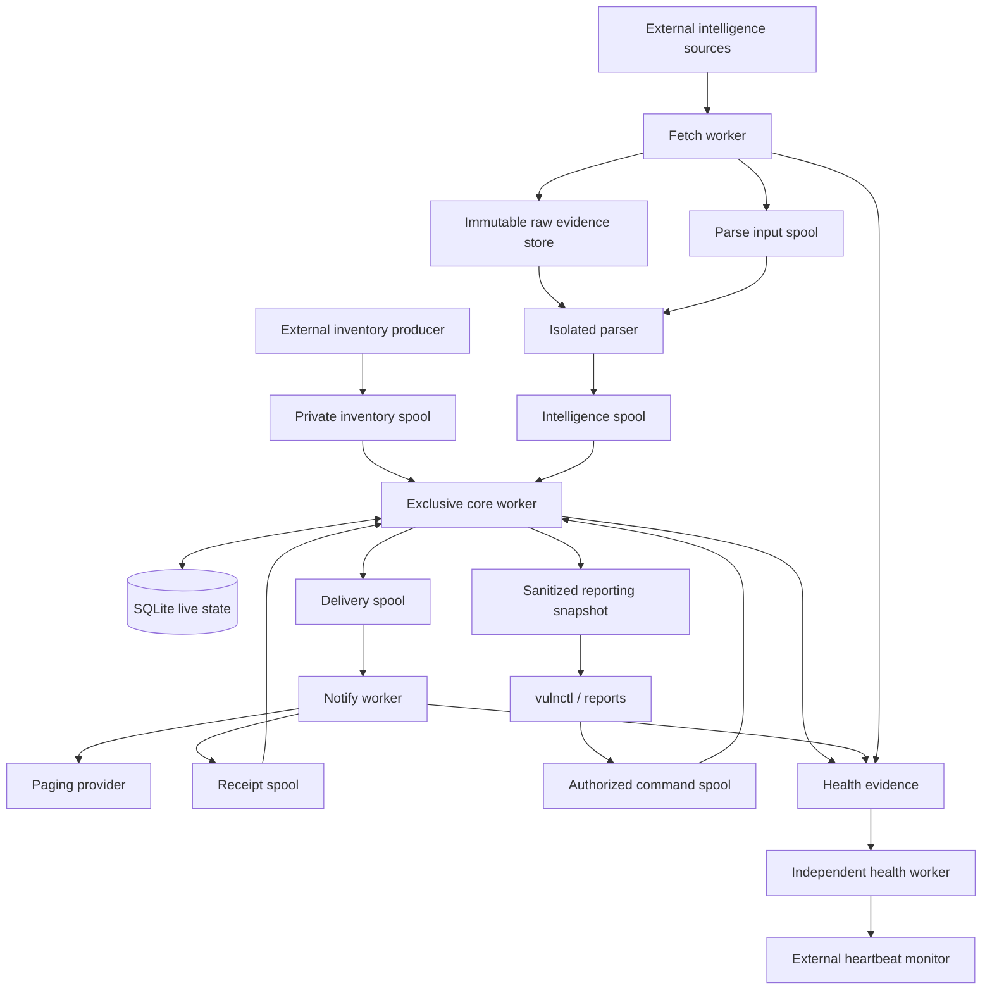

*Figure 1 — Initial execution model. Arrows represent data hand-off, not direct access to the live database. Fetching and parsing run as separate identities. Inventory never flows into the raw external advisory store.*

### 4.1 Logical modules and execution

| Module / command | Responsibility | Execution pattern |
|---|---|---|
| `inventoryd` / intake | Validate external inventory, producer/scope and coverage | Authenticated intake; publish manifest |
| `inteld` / fetch | Acquire configured sources, archive bytes, preserve provenance | Per-source timers |
| `inteld` / parse | Normalize hostile input, deterministic early-warning candidate extraction | Isolated bounded oneshot |
| `correlatord` / correlate | Authoritative state, identity, matching, policy, lifecycle, outbox export | Short-lived batches; one DB UID |
| `notifyd` / notify | Deliver jobs, retry, return receipts; no live DB access | Short-lived bounded worker |
| `watchdog` / health | Observe progress, verify deadlines, send external heartbeat | Independent periodic command |
| `vulnctl` | Local queries, inspection, controlled administrative commands | On demand; exported state or command spool |
| `analystd` | Optional semantic extraction and enrichment | Deferred; bounded asynchronous work |
| `webui` | Optional separate reporting and management | Deferred; no live DB access |

Module names inherited from v0.2 do not imply daemon processes. A single Python distribution with multiple command entry points is sufficient. Systemd is the supervisor. Separate processes and identities are justified by distinct trust boundaries, not by a desire for microservices.

## 5. Inventory input and reference producer

Inventory generation remains outside Vulnmon's core architectural boundary, but is a mandatory project dependency for operational v0. The reference producer must supply real evidence from a representative workload before the real-data correlation milestone. Synthetic fixtures are sufficient for developing contracts and the initial storage prototype only.

### 5.1 Input contract

| Data group | Minimum information |
|---|---|
| Asset | Stable asset identity, environment, OS/release, architecture |
| Component | Stable instance ID, ecosystem, name, exact installed version, source package where relevant |
| Provenance | Installation method, repository/vendor, image digest or artifact identity, evidence and confidence |
| Runtime | Running version, SAPI/workload, process or deployment identity, relevant effective configuration, restart evidence |
| Observation | Producer, scope, generation/revision, observed time, per-capability completeness and collection errors |
| Context | Exposure, owner, business criticality, crown-jewel membership, EOL where known |

Unknown values and collection failures must be explicit. Identity does not incorporate version; upgrades and rollbacks preserve stable instance identity. Multiple instances of a package on the same asset require workload/install-scope differentiation. Inventory must not contain secrets or arbitrary environment dumps.

Completeness is per capability and declared scope, not a single global boolean:

```json
{
  "producer": "reference-ubuntu",
  "scope": "example-workload",
  "revision": 42,
  "coverage": {
    "installed_packages": "complete",
    "package_provenance": "partial",
    "running_processes": "complete",
    "runtime_configuration": "partial",
    "application_dependencies": "not_collected"
  }
}
```

Illustrative fragment, not a finalized schema. The activation rule is per authoritative coverage partition: only a complete validated generation may replace the corresponding prior complete partition. Partial observations remain available as positive evidence and coverage warnings, but cannot delete old observations or justify closure. Cross-partition evaluation records all relevant revision identifiers. Full snapshots are the initial contract; deltas are deferred until base revision and ordering semantics are specified.

### 5.2 Reference inventory producer v0

| Collection capability | Candidate mechanism / limitation |
|---|---|
| OS/release and architecture | `/etc/os-release`, package and host metadata |
| Installed binary/source packages | `dpkg-query -W -f=...`; preserve complete Debian versions |
| Provenance | APT metadata (`apt-cache policy`), install records, artifact evidence; current repository metadata alone is not proof of origin |
| Runtime and restart status | `needrestart -b`, process and service evidence; not universal proof of correct running code |
| PHP | Actual serving SAPI (FPM/Apache as applicable), version and effective relevant ini settings, including `session.upload_progress.enabled`; CLI-only data is not FPM evidence |
| Composer | Lockfile and deployed artifact metadata, with observation scope |
| Delivery | Existing Ansible or authenticated SSH/HTTPS transport; choose with infrastructure owner |

A reference producer should use existing operational tooling where possible. It must not expose a public diagnostic PHP endpoint or collect arbitrary secrets. Missing runtime capability is recorded and may block verified remediation even when package matching succeeds.

**Project gate:** nominate an accountable Sysadmin/DevOps owner, backup and calendar delivery date before committing to real-data Phase 2. Owner and date are unassigned in this document. The owner must demonstrate collection against a representative real PHP deployment and document coverage limitations. See Section 16.

## 6. Intelligence acquisition and evidence

### 6.1 Source selection and schedules

| Class | v0 candidate | Purpose |
|---|---|---|
| Distro | Ubuntu USN / Ubuntu OSV data | Release and package-specific fixes/status |
| Application dependencies | OSV Composer ecosystem | Application library version ranges |
| Exploitation | CISA KEV | Known exploitation evidence; not the first or only signal |
| Direct vendor / mail | PHP security announcements, php-announce, oss-security | Early warnings, upstream ranges, pre-announcements and follow-ups |

Exact endpoints, formats, source authenticity, licensing, source-specific coverage and rate limits must be checked before adapter activation. Broader GHSA/CVE List/NVD/EPSS support is deferred unless required by the approved v0 acceptance scope; preserve all scores received from enabled sources and visibly report missing coverage. A process owner must approve any temporary difference from the full daily digest/enrichment process.

### 6.2 Fetch/parse separation

The fetch worker performs controlled HTTPS/mail acquisition, archives original bytes and publishes a parse manifest. It MUST NOT read inventory, live state or delivery credentials. Parsing hostile bytes occurs under a separate network-restricted identity, with bounded CPU/runtime, memory, decompressed size, nesting, record counts and input/output size. Disable external entities/DTD processing where applicable; avoid unbounded regular expressions and unsafe deserialization. A parser must not inherit fetch credentials or access unrelated spool contents.

Restrict fetcher egress to approved source destinations, preferably through a hostname-restricted forward proxy controlled by infrastructure. A fetcher identity can reach only the proxy where feasible; the proxy must enforce permitted hosts, ports and protocols and prevent bypass. Validate every redirect and prohibit unsafe scheme changes, unexpected hosts and private/loopback destinations except explicitly approved internal endpoints. Use verified TLS, bounded redirects, timeouts, size limits and safe decompression. The exact proxy/network configuration is pending infrastructure validation.

### 6.3 Immutable evidence and source checkpoints

Each raw document is stored by content hash before its manifest is published. Record source identity, source item ID, original URL or message reference, claimed publication timestamp, first observed/retrieved time, raw hash, parser version, normalized revision and ingestion time. Preserve original bytes and every materially distinct revision, not only current feed state. A raw hash proves byte identity, not authenticity or truth.

Source claims remain distinct. Contradictory evidence must not be silently merged. A checkpoint advances only after its corresponding inputs are durably retained in the evidence store and recoverable spool, or after core acceptance if the source cannot safely replay from that spool. A fetch/parse failure retains prior evidence, reports lost coverage and does not advance past unretained data. A deterministic retry can reconstruct manifests from archived bytes.

### 6.4 Deterministic early warning is primary

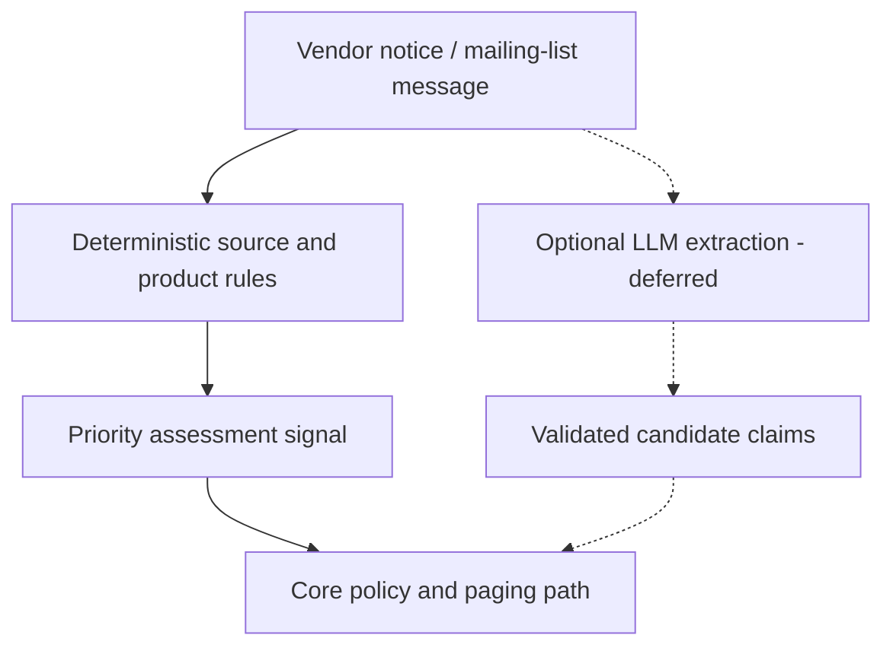

*Figure 2 — The optional LLM enriches the signal; it cannot gate or suppress it.*

For designated crown jewels, configured source/product rules produce immediate assessment independently of CVE availability and the LLM. A credible vendor emergency/pre-announcement follows the P0 rule. Proposed operational configuration: low-volume trusted vendor security lists may page directly on relevant security signals; higher-volume lists such as oss-security produce an assessment alert with acknowledgement deadline and escalation if unattended. Broad matches do not by themselves establish applicability. Do not suppress a signal solely because of model output or unverified negative evidence.

The initial thresholds and source list require security/on-call approval. Collect message, match, page, false-positive and missed-signal counts for the first month; tune against measured volume and replay, not speculative alert fatigue. Human subscriptions remain an independent coverage path.

## 7. Deterministic correlation and policy

The core owns canonical inventory and advisory state, durable reconciliation jobs, finding identity, evidence-backed decisions, lifecycle and outbox. Logical engines communicate through Python calls and explicit domain-level persistence operations, not mandatory network services.

| Engine | Responsibility |
|---|---|
| Ingestion and identity | Validate inputs again at the trust boundary, resolve stable identity and aliases, preserve revisions and enqueue affected work |
| Candidate selection | Indexed ecosystem, product, package and deployment identities; group identical builds without losing exposure context |
| Applicability | Resolve provenance, ecosystem ranges, deployment/configuration conditions and conflicts |
| Policy | Versioned deterministic priorities, conservative emergency assessment, SLA and override eligibility |
| Lifecycle | Durable finding identity, evidence history, reopen, mitigation, verification, disposition and risk expiry |
| Persistence and events | Bounded state transitions, revision checks, durable job/outbox commits and exports |

### 7.1 Provenance-aware applicability

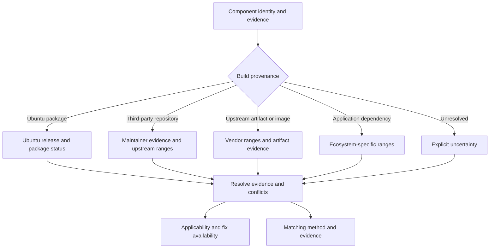

*Figure 3 — The origin of a component, not merely its host OS, determines the applicable source authority.*

| Provenance | Matching authority and limits |
|---|---|
| Official Ubuntu package | Exact release, source/binary package identity as appropriate, architecture and full distro version; Ubuntu status/fixed version takes precedence for that build |
| Third-party APT / PPA | Maintainer status and build/patch evidence preferred; upstream ranges are candidate evidence, not proof of downstream patch state |
| Official upstream image / source build | Vendor ranges plus actual version, image digest/build provenance and local patch evidence; tags alone are insufficient |
| Composer package | Ecosystem-specific package identity and Composer-compatible ranges; deployed artifact evidence where available |
| Unresolved origin | Unknown; retain upstream candidate matches and investigation priority |

Do not apply Canonical package fix versions to a PPA or container build merely because it runs on Ubuntu. Do not infer a fixed downstream build from an upstream version without evidence. For the deployed PHP population, determine installation methods before choosing exact adapter and matcher coverage. The matcher must record method, build provenance, source revisions, version semantics, runtime condition evidence and reasons for unresolved or conflicting claims.

### 7.2 Independent assessment dimensions

| Dimension | Values / meaning |
|---|---|
| Applicability | `affected`, `not_affected`, `fixed` (observed build contains applicable fix), `unknown` |
| Fix availability | `unknown`, `unavailable`, `available`, `not_planned` for the relevant deployment path |
| Remediation lifecycle | New, Triaged, Scheduled, Mitigated, Fixed-verified, Risk-accepted; explicit non-applicable/removed dispositions |
| Delivery | Pending, dispatched, delivered, failed, escalated; human acknowledgement tracked separately |

Fix availability must preserve original source status (e.g. needed, deferred, ignored), applicable version, release/channel and timestamp. A separate eligibility attribute captures whether the fix is obtainable for the observed deployment, requires subscription or upgrade, or is uncertain. A fix existing upstream does not mean it is available on the installed branch. EOL is a standing risk, not an implied resolution. A fixed build must not imply verified runtime remediation.

### 7.3 Policy for crown jewels and uncertainty

The proposed conservative policy below requires explicit Security and Sysadmin/DevOps approval. It is intended to prevent a credible emergency from becoming a quiet unknown merely because a third-party build or configuration could not be resolved.

| Evidence and context | Proposed action |
|---|---|
| Confirmed applicable P0 condition under governing policy | Page P0 immediately |
| Credible P0-class signal for a present or plausibly present crown jewel; upstream affected range matches or relevant applicability remains unknown | Provisional P0 assessment/page with equal urgency; expose uncertainty and evidence gaps |
| Relevant vendor emergency release or pre-announcement for crown jewel, details incomplete | P0 preparation/assessment without waiting for CVE or LLM |
| Generic unsupported origin, missing inventory or stale evidence without a particular credible emergency signal | Visible coverage gap and owner investigation; escalate by approved coverage policy, not automatic P0 for every absent match |
| Positive, current evidence proves non-applicability or corrected status | Record reason/evidence; risk-reducing P0 transition follows approval rules below |

The distinction is essential: uncertainty about a credible critical event must fail conservatively; generic missing information must not create unbounded emergency pages. Unknown is never recoded as affected simply to drive escalation. Priority and applicability remain separate. Policy retains all source scores and the highest available score where required; missing scores do not block impact-class escalation. KEV, public exploitation evidence, exposure and criticality influence priority under the governing policy. Exact thresholds and rule version are configuration, not adapter logic.

### 7.4 Finding identity, lifecycle and disposition

A vulnerability receives a stable internal identifier before or after CVE assignment. CVE, GHSA and vendor identifiers are aliases only when evidence establishes equivalence; related follow-up vulnerabilities may require separate findings. Identity reconciliation must preserve historical aliases, decisions, notification IDs and references. It must not reset SLA clocks or suppress unresolved remediation. Ambiguous merges require review.

Findings link a vulnerability to a stable component instance within an asset/workload; reporting may aggregate instances into one engineering obligation without losing the per-instance record.

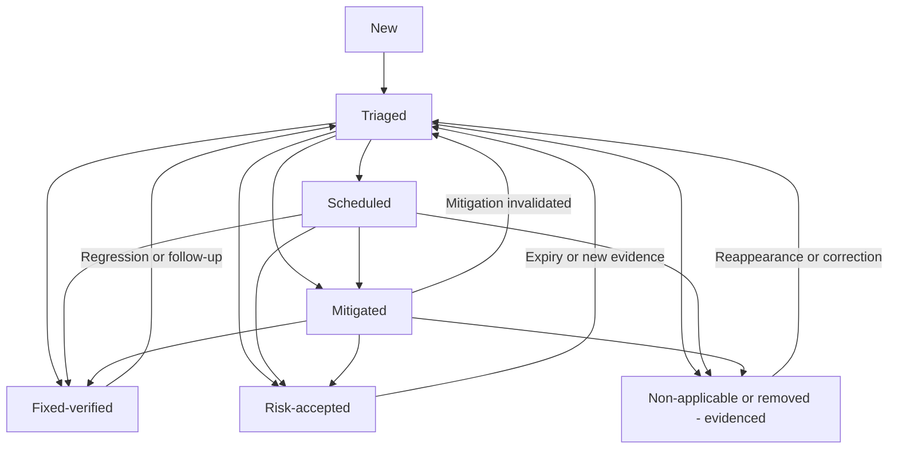

*Figure 4 — Process-aligned lifecycle; conceptual paths, not a mandatory sequence. Closure requires appropriate authority and evidence.*

Remediation verification checks running version, deployment/replica coverage, restart/worker evidence and relevant mitigation configuration. Component removal requires complete authoritative coverage or positive removal evidence; stale inventory cannot close a finding. Retain original automated assessment, policy version, actor, timestamp, reason, expiry and supporting evidence for human overrides. Risk acceptance remains visible residual exposure.

**Pending approval:** P0 downgrade, suppression, non-applicability override or risk acceptance must require two independently authenticated authorized identities, with risk-owner approval as applicable. The second approver and backup must be on the rotation; absent approval leaves the P0 active. Escalation, acknowledgement and pre-approved containment must not be delayed by this rule. A tightly scoped temporary notification pause, if permitted at all, requires explicit approval policy, expiry and continued visible P0 status; it never changes applicability or erases evidence. If v0 cannot implement independent approval safely, the risk-reducing commands remain disabled.

## 8. Output, administration and optional AI

### 8.1 Notification worker and integration boundaries

The core creates outbox events atomically with decisions and exports minimum-necessary delivery envelopes. The notify worker does not open the live database, even read-only. It delivers using configured channel credentials, records attempts durably and publishes a receipt. Stable event and attempt IDs support at-least-once delivery, retry, deduplication where supported and escalation. Provider acceptance, observed delivery and human acknowledgement are separate facts. A provider without delivery confirmation must not be reported as confirmed delivered.

The initial mandatory integration is an approved paging path, including observable human acknowledgement and alternative escalation route. Daily readable reports and an exclusion appendix can be generated without Jira, Confluence or AI. Excluded items require a positive evidence-backed reason; unknown items are not silently excluded.

Jira/Confluence automation is deferred. When introduced, publish technical state one way from the core; Jira coordinates engineering work and Confluence holds reporting. Closing a Jira issue cannot mark technical remediation verified. Inbound workflow synchronization is not planned. Narrow authorized commands (acknowledge, record mitigation or verification, request/approve override, accept risk) may be provided through the CLI or a later constrained webhook, with version and identity checks. No unrestricted SQL or generic bidirectional sync.

### 8.2 Management and read access

Only the dedicated core UID ever opens the live SQLite database. `vulnctl`, notification, reporting, analyst and portal identities must not have access to the live database or its WAL/SHM files. Instead the core publishes sanitized, immutable report snapshots (JSON or a separately finalized SQLite reporting artifact). A SQLite report export must be made using a supported consistent backup/materialization method, closed, finalized without dependence on live sidecars, and atomically published; the live database must never be copied as an ordinary file. Publish report generation and state revision; report age must be visible. Retain only necessary fields, with audience-specific access and retention.

On-demand authoritative query/report refresh, if required, runs through a narrow authorized request processed by the core UID. Administrative commands are typed, versioned manifests in an authorized spool, with identity derived from authenticated submission, not caller-provided actor strings. Responses are durably published to authorized destinations. A non-privileged caller must not be able to run arbitrary Python or SQL as the core UID. Replay uses isolated state and suppresses real notifications by default.

### 8.3 Optional local LLM (deferred from v0)

The LLM may extract candidate claims from unstructured material or produce attributed explanations for existing findings. Deterministic early warning, structured matching and emergency notification do not depend on it. Model selection, hardware and inference deployment are deferred; no custom model training is assumed.

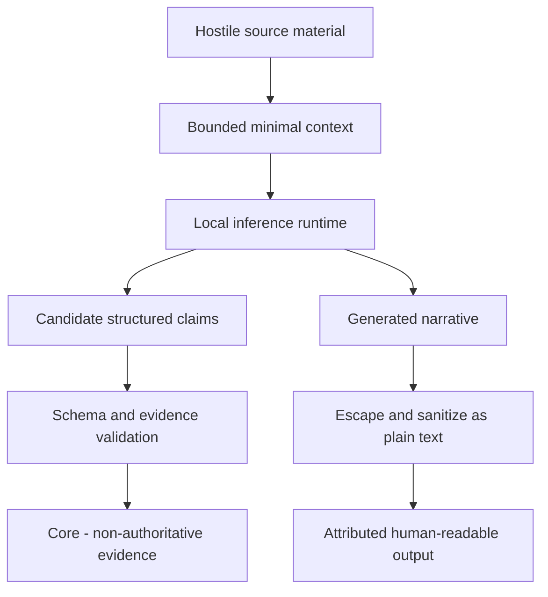

*Figure 5 — Separate validation of machine claims and human-facing narrative.*

Model output remains untrusted. Schema validation proves shape, not truth. Claims retain source references, supporting excerpts and uncertainty. They may propose investigation but cannot suppress an alert, assert definitive non-applicability, approve risk or declare remediation verified. The model receives minimized context; omit infrastructure identifiers, secrets and unrelated inventory unless necessary and authorized. No production credentials, arbitrary tools, general egress or live database access.

Render generated narrative as escaped plain text with a machine-generated label. Do not allow active markup, embedded images, model-created links, macros or automatic link expansion where controllable. Construct separately displayed links from validated source metadata under destination policy; appearance in a hostile document is not sufficient validation. Treat operational instructions as advisory and verify them against primary evidence. Apply the same presentation controls to untrusted excerpts even without AI.

## 9. Persistence, spools and bounded work

### 9.1 Logical data model

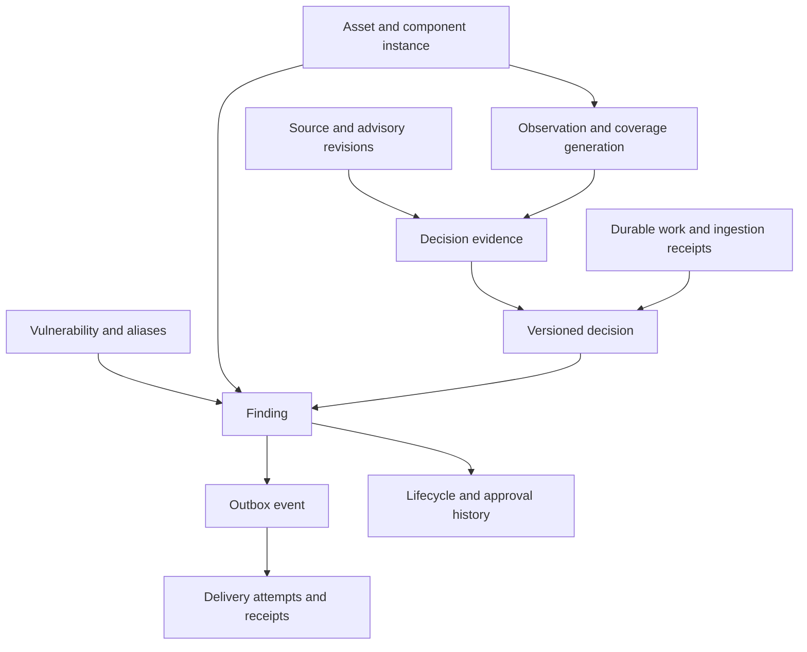

*Figure 6 — Conceptual relationships, not a physical schema. Source revisions, generation coverage, policy revisions and delivery history must remain independently addressable.*

The core persists stable assets/components, observations, inventory generations/coverage, vulnerabilities and aliases, advisories and immutable source revision references, decisions, findings, overrides, approvals, jobs, ingestion receipts, outbox events and delivery attempts. Policy and configuration revisions are evidence. Maintain foreign keys and explicit migrations. Retention and backup policy must preserve records still referenced by active findings, jobs and replay requirements.

### 9.2 Exclusive live database ownership (DB-01)

SQLite WAL permits concurrent readers and one write transaction per database. Per-table ownership is a programming convention, not an enforceable SQLite permission boundary; any UID with write access to the database can potentially change every table. WAL readers may also depend on access to the SHM/WAL sidecars. Therefore only the core UID opens the live database; no other identity relies on read-only WAL behavior or permissions on sidecars.

The core owns the private state directory and database, including WAL/SHM and a persistent lock file, with restrictive permissions (initially directory 0700 and files 0600, validated on deployment). Protect the path against unintended aliases and untrusted directory writers. Only explicitly installed core entry points may run as this UID. Root and infrastructure administrators remain trusted privileged operators; a UID is not protection against root.

Multiple scheduled core invocations may contend for a persistent advisory lock. **Acquire the exclusive lock for a bounded unit of work, not for a daily run or full reconciliation.** Never unlink or recreate the lock file while workers can hold it. Close live connections and release the lock at each safe batch boundary. Avoid external I/O, waiting for users, expensive parsing and prolonged matching under write transactions. For CPU-heavy evaluation, read bounded candidate/revision data, close the connection, release the lock, evaluate and reacquire for a revision-checked commit; stale work is discarded and requeued. Durable work claims/cursors with recovery semantics prevent two workers from treating the same batch as completed.

### 9.3 Filesystem communication contract

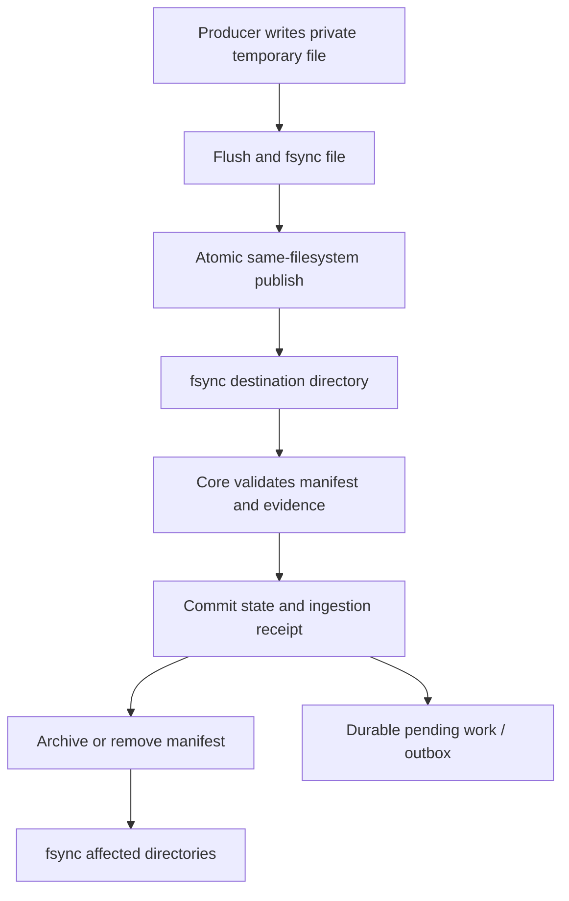

*Figure 7 — Durable publication and acknowledgement. A crash after commit but before cleanup causes an idempotent replay, not a second state transition.*

Use versioned JSON/NDJSON manifests and immutable blobs. Required envelope fields include schema version, producer/source identity, stable message ID, kind, creation/observation timestamp, revision/scope as relevant, content hash and bounded payload or safe blob reference. Validate authorized identity through operating-system permissions or authenticated intake; a manifest field is not authentication.

Write temporary files in the destination filesystem, flush and `fsync()` the file, close it, atomically publish under a unique stable name without silently overwriting a conflicting message, then `fsync()` the destination directory. If a cross-directory rename is used, sync both affected directories. Publication is not acknowledged until durability operations succeed. Do not rely on rename alone. Use safe no-clobber publication (e.g. link-based publication with cleanup, or collision-safe rename semantics) and compare hashes on identical retry IDs. Raw evidence is made durable before referencing it. Accept only regular files in expected directories, reject path traversal/symlinks and enforce size limits; prevent untrusted mutation of bytes after validation by taking a private copy or equivalent ownership transfer before processing. Filesystem permissions alone do not make a producer's data trustworthy.

Acknowledge core ingestion only after committing the input identity, evidence/state changes and required durable job. Archive/remove consumed manifests after commit and sync affected directories; a replay after an interrupted cleanup is harmless. Malformed or conflicting input goes to bounded quarantine with reason and independently visible alert; do not repeatedly trigger a path unit on poison files. Disk full, sync failure and permission errors are explicit failures; never report success on partial publication. Define per-producer quotas and reserve urgent/receipt capacity, plus monitor inode and byte utilization. Path activation is an optimization; timers and recovery scans catch missed events and retry work.

### 9.4 Durable outbox and delivery receipts

A transactional outbox solves the boundary between authoritative commits and external side effects even without a message broker. A finding/decision and required event are committed in the same transaction. A core export job materializes an immutable delivery envelope with stable event/attempt ID. Database state and filesystem publication are not one atomic transaction: export pending jobs idempotently, retain them until valid receipt or defined terminal disposition, and regenerate missing envelopes on recovery.

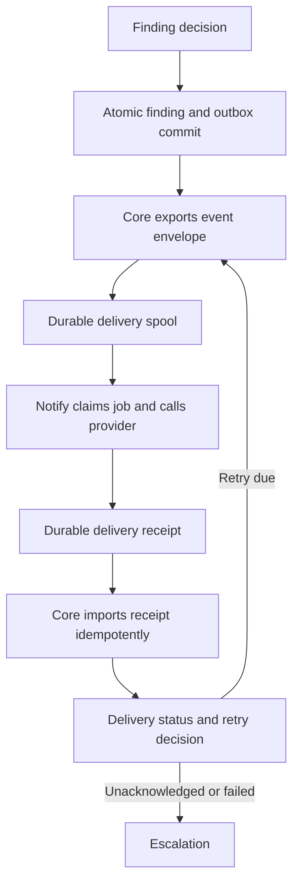

*Figure 8 — No direct database access by notification adapters. External delivery is at least once, not exactly once.*

The notify worker uses a private claim/attempt journal or exclusively locked bounded job claim, with expiry/recovery, to avoid simultaneous duplicate delivery. It must not hold the core lock while calling providers. Receipt publication uses the same durable protocol as input; receipts are authorized, correlated to expected event/attempt IDs and cannot mutate applicability. A crash after provider acceptance but before a durable receipt may cause repeat delivery; use provider idempotency keys when available and report ambiguous outcomes honestly. Retries and escalation must survive restart. No event is considered successfully handled solely because its spool file disappeared.

### 9.5 Bounded batches, emergency priority and backpressure (DB-02)

| Class | Work |
|---|---|
| Urgent | Credible emergency intelligence intake and assessment; P0 decisions, notification export and receipts, acknowledgement/escalation |
| Normal | Routine advisory changes, lifecycle, source status and authorized management |
| Bulk | Inventory staging, historical imports, daily reconciliation, retention and reporting |

Before every bounded core batch, choose work under trusted source/context rules; untrusted producer priority labels are not authoritative. Urgent work has precedence and reserved capacity; fairness/aging guarantees bulk progress under sustained emergency load. Pending urgent manifests and durable jobs must be reconsidered between batches. Release the lock after each batch, including between successive staging batches and reconciliation pages. Contending systemd invocations must use bounded waits/retry and not rely on flock fairness. Prefer one batch scheduler command that checks all classes, with a frequent recovery timer; separate invocations use the same selection rules. A long running scheduler loop must yield the lock and honor its execution budget. A transaction already running is not preemptible. No lock held across network/LLM calls, report rendering or user interaction.

| Experimental tuning parameter | Proposed starting point |
|---|---|
| Bulk batch size | 500–2,000 records, adaptive to measured latency |
| Desired bulk write transaction duration | <= 100 ms |
| Desired routine write transaction duration | <= 50 ms |
| Desired urgent batch dispatch delay after eligible work is selected | <= 250 ms within an active scheduler run |
| SQLite busy timeout | 5 s initial setting, not a transaction deadline |
| Core recovery timer | 1 min proposed; path activation may shorten wake-up |

These are engineering starting points, not hard real-time guarantees; a timer wake-up, lock contention, storage stall or parser failure may exceed them. Measure queue age from durable publication and include scheduling/wakeup latency in the end-to-end budget (Section 11). Prevent starvation by a bounded service allocation/aging rule tested against sustained urgent traffic. Reject or defer unaccepted work explicitly under overload and retain recoverable source inputs. A daily full reconciliation is resumable and must not monopolize the lock or starve P0 processing.

### 9.6 Atomic inventory activation and revision consistency (DB-03)

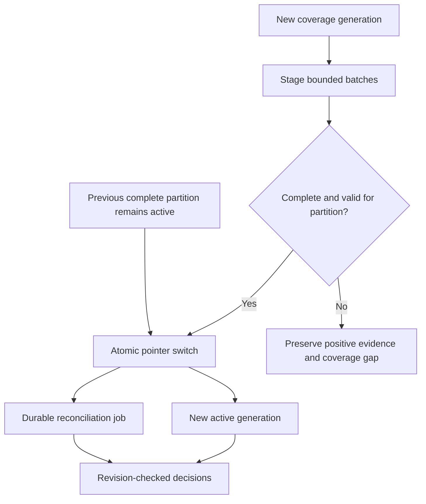

*Figure 9 — Partial input cannot erase the previous complete partition. Activation and enqueue are one transaction.*

Use stable generation IDs scoped by producer and declared coverage partition; verify revision ordering, count/integrity, completeness and expected scope. Stage in bounded commits. A retry must use the same ID and same content or be rejected. Activation switches the pointer and enqueues durable reconciliation in one transaction. Incomplete/failed staging is visible and cannot infer removal. Evaluate urgent evidence against the last complete observations and positively observed newer exposure conservatively; never use staging absence as evidence of safety.

Reconciliation records inventory, advisory and policy revisions; validate them at decision commit. If any relevant input changed, discard or requeue stale calculations rather than overwriting new decisions. Both inventory changes and intelligence changes trigger matching. Reopening after rollback/follow-up preserves finding identity and audit history. Retire old generations only under an approved retention policy and after referenced jobs/evidence are safe.

### 9.7 SQLite durability, reader bounds and migration (DB-04/05)

Initial writer configuration:

```sql
PRAGMA journal_mode = WAL;
PRAGMA synchronous = FULL;
PRAGMA foreign_keys = ON;
PRAGMA busy_timeout = 5000;
```

Verify WAL at initialization and configure connection-scoped settings on every relevant connection. All live read transactions are short and core-owned; snapshot exports are bounded and should not pin the WAL indefinitely. Observe WAL size, checkpoint progress, disk space, transaction duration and lock errors. Keep default automatic checkpoint behavior initially; change only on evidence. SQLite is on a local filesystem inside the central VM; several hosts must not open a shared WAL database over NFS. Proxmox virtual disks backed by shared storage are distinct from sharing the database file between guests. Validate flush/durability behavior and commit latency on the actual storage stack. Verify the loaded SQLite runtime, including the upstream WAL-reset corruption fix or an applicable Ubuntu backport; upstream version alone is not proof of patch status.

Back up using SQLite-aware consistent methods with referenced evidence, spool recovery state and versioned policy/configuration. VM snapshots alone are not the application backup plan. Test restore and reconcile pending delivery. Backup retention, RPO/RTO and availability targets require owner approval.

Maintain a small domain persistence interface and explicit SQL migrations, not an ORM solely for future portability. Preserve atomicity of decisions and outbox; splitting into several SQLite databases would add cross-file consistency and recovery complexity and is not the baseline. Evaluate PostgreSQL only if measured queue saturation or emergency latency cannot be corrected, or active writers across machines, replication/HA or analytical requirements justify it. A single VM remains a failure domain.

## 10. Principal execution flows and runtime layout

### 10.1 New intelligence or inventory

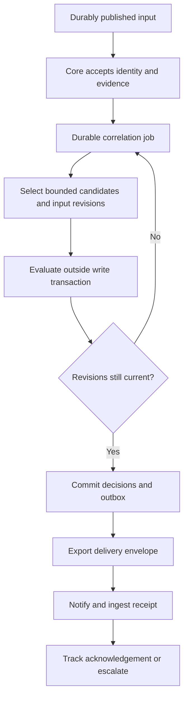

*Figure 10 — Both input directions use recoverable jobs. A stale result is never published as a current decision.*

New intelligence is matched to known inventory; new inventory is matched to existing intelligence. Changed advisories, exploitation signals, policy revisions and expiring exceptions also trigger reevaluation. The daily consistency check is the recovery path, not the only source of correlation. An urgent provisional signal may page before exact applicability or a CVE is established. Later evidence updates the same obligation or creates a related finding when warranted.

### 10.2 Scheduling defaults

| Command | Activation | Proposed initial cadence / constraint |
|---|---|---|
| Fetch (crown-jewel feeds, KEV) | Per-source timer | Every 15 min, subject to verified source limits; no uncontrolled random delay |
| Fetch (routine sources) | Per-source timer | Daily initially or according to source-specific freshness requirements |
| Parse | Timer and optional path activation | Promptly; recovery sweep at least every 1 min |
| Correlate / export | Timer and optional path activation | Recovery sweep every 1 min; bounded priority-aware batches |
| Notify | Timer and optional path activation | Every 1 min for pending/due work; retries follow deadline and backoff |
| Health | Independent timer | Every 1 min; external heartbeat deadline proposed at 5 min |
| Reconcile / report | Daily timer | 07:00 local operational schedule; digest reviewed by 10:00 per existing process |

Proposed cadences require load/source validation and operational approval; they are not actual deployed schedules. Configure systemd timer accuracy and jitter to meet the budget. Avoid overlapping runs of the same non-reentrant source worker; a missed activation must not lose durable work. A systemd path unit rechecks monitored paths on service completion; drain eligible work or quarantine poison files and use a retry timer rather than an activation loop. Timer failure and queue age are independently visible.

### 10.3 Proposed filesystem layout

```text
/etc/vulnmon/                   # Versioned policy and source configuration
/var/lib/vulnmon/
    core/                       # Private to core UID
        state.db
        writer.lock
    evidence/                   # Immutable advisory bytes, controlled access
    notify/                     # Private delivery attempt journal
    reports/                    # Sanitized finalized snapshots
    health/                     # Minimal progress evidence
/var/spool/vulnmon/
    inventory/                  # Separate authorized producer intake
    parse/                      # Fetch -> parser
    intelligence/               # Parser -> core
    commands/                   # Authorized human/control operations
    delivery/                   # Core -> notify
    receipts/                   # Notify -> core
    quarantine/                 # Partitioned by trust domain
```

Directory names are illustrative; permissions, ownership, mount layout, quotas and producer/consumer hand-off are part of deployment specification. A single shared writable spool directory is not acceptable. Raw evidence is separate from private inventory. Credentials remain outside source control and are accessible only to the corresponding service identity.

## 11. Emergency latency and health objectives

### 11.1 Define the clocks before measuring

The governing process currently states hourly fast-lane polling, P0 paging within one hour, and duty sysadmin confirmation of applicability within 30 minutes of the page. Hourly polling alone can consume the page budget. The proposed operational amendment is 15-minute polling for crown-jewel sources and KEV, a 45-minute technical page budget, plus a separate human acknowledgement objective. This document does not amend the governing process by itself.

| Clock | Meaning |
|---|---|
| `source_available_at` (T0) | Earliest time an item is fetchable from a configured source under healthy source conditions; known precisely in replay, often estimated or unknown in live operation |
| `published_at` | Source-reported publication time; may differ from actual availability |
| `observed_at` | First successful acquisition by Vulnmon |
| `parsed_at` / `accepted_at` | Parsed manifest and durable core acceptance |
| `evaluated_at` | Initial actionable decision, including provisional P0 |
| `dispatched_at` / `delivered_at` | Submitted to provider / delivery confirmed where observable |
| `acknowledged_at` | Human responder acknowledges the page |
| `confirmed_at` | Human confirms applicability or records an authorized disposition; not the same as acknowledgement |

Use UTC for stored events and monotonic elapsed time for local duration measurement. Never invent T0 or use source publication time as guaranteed availability. For live sources, bracket T0 between the last successful observation without the item and first observation with it, where feed semantics permit; report uncertainty. During source outages report degraded coverage, not successful SLO compliance. Measure internal observed-to-delivery separately; controlled replay provides known T0 for end-to-end acceptance.

### 11.2 Proposed allocation (pending human approval)

| Technical stage | Budget | Cumulative from T0 |
|---|---:|---:|
| Polling / scheduling wait | 15 min | 15 min |
| Fetch, archive and durable hand-off | 5 min | 20 min |
| Parse and durable intake | 5 min | 25 min |
| Correlation, policy and outbox/export | 10 min | 35 min |
| Dispatch, provider delivery and initial retry | 10 min | 45 min |
| Human acknowledgement after delivery | 15 min | 60 min |

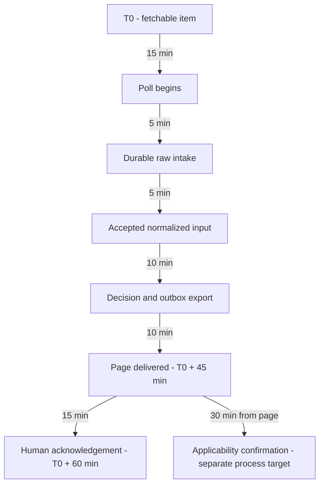

*Figure 11 — Proposed page and human-response objectives. The 15-minute allowance after delivery is not extra technical retry time.*

Propose delivery in <=45 minutes from T0 under healthy source/provider conditions, with acknowledgement by T0+60 minutes and no later than 15 minutes after delivery. An unacknowledged page is not a completed emergency response. Applicability confirmation retains the current process's separate 30-minute target after paging; if the organization requires confirmation within the same one-hour envelope, the budget must be renegotiated and the process amended explicitly. Page delivery and human response are distinct acceptance measures. Do not silently conflate these clocks or extend the existing confirmation target.

If delivery fails or acknowledgement is overdue, escalate through the approved backup route/rotation; do not wait for the daily report. The final channel-specific retry, backup timing, human acknowledgement and confirmation policy belongs to operations/security. Monitor absolute deadlines even if stage measurements are incomplete.

### 11.3 Watchdog and dead-man's-switch heartbeat

The independent health worker consumes minimal progress evidence from fetch, parse, core and notify, plus spool age and external provider signals where available. It must not open the live database; the core exports bounded health evidence and its own transaction/checkpoint metrics. Monitor receipt freshness and ensure the health export itself is current. The external heartbeat represents verified progress and healthy coverage, not merely successful watchdog execution. Send a degraded signal or independent alert when unhealthy and do not renew a healthy heartbeat falsely. External monitoring alerts on heartbeat silence (proposed five-minute deadline), including VM/cluster loss, and should also retain independent infrastructure monitoring.

| Indicator | Proposed warning / breach criterion |
|---|---|
| Crown-jewel source overdue | No successful fetch within approved poll interval plus acquisition allowance; report source health |
| Urgent parse backlog | Oldest accepted raw urgent input exceeds 5 min |
| Urgent correlation backlog | Oldest accepted actionable urgent input exceeds 10 min |
| Pending emergency delivery | Oldest eligible event exceeds 10 min without confirmed delivery or explicit escalation |
| Human acknowledgement | No acknowledgement within 15 min of confirmed delivery or absolute 60-minute deadline, whichever is earlier |
| Full-path objective | 45-minute technical delivery / 60-minute acknowledgement target breached, with T0 uncertainty reported |
| Core state/report freshness | Export age exceeds configured recovery interval plus bounded execution allowance |
| Local resources | Spool byte/inode quota, free disk, WAL/checkpoint, busy/lock errors; set deployment thresholds after measurement |

Alert earlier where remaining budget is insufficient. Health monitoring cannot itself guarantee deadlines; notification-provider failures and lost telemetry remain visible. No reliance solely on notify for health alerts. Persist metrics for queue depth/oldest age by class, transaction and lock-wait P95/P99, ingestion throughput, generation activation lag, stale-result requeues, WAL size/checkpoint progress, read/export duration, delivery latency, acknowledgement and storage sync latency. Review actual alert volumes after one month and performance/SLA targets after the first quarter as appropriate.

## 12. Deployment, privileges and threat model

### 12.1 Trust boundaries

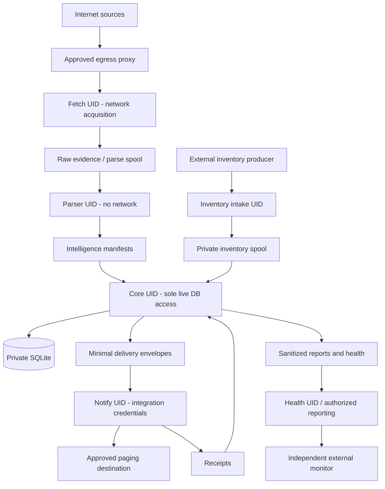

*Figure 12 — Distinct operating-system identities and storage boundaries within the central Ubuntu VM. Optional AI and web applications are deferred.*

| Identity | Network | Sensitive inventory / live DB | Credentials and permitted writes |
|---|---|---|---|
| Intake | Approved producer transport only | Inventory required; no live DB | Own intake spool, intake authentication |
| Fetch | Approved source proxy only | Neither | Raw evidence publication, parse spool, source credentials if necessary |
| Parse | None | Neither | Read required raw bytes; own intelligence/quarantine output |
| Core | None required | Full authorized access; sole live DB UID | Private state, authorized evidence references, exports and receipts processing |
| Notify | Approved delivery destinations | Minimal envelope only; no DB | Integration credentials, attempt journal and receipt spool |
| Health | Independent monitoring endpoint | Minimal health only; no DB | Monitoring credentials and progress alerts |
| CLI / report users | Local/authorized | Sanitized exports; no DB | Authorized command submission; no arbitrary core execution |
| Optional analyst | Private inference API only | Minimized approved context; no DB | Candidate results only; no production/integration credentials |

Dedicated identities, file access controls and explicit per-direction hand-offs are mandatory. Do not assume grouping of commands in one VM provides isolation. The parser is isolated even for structured source inputs. Example starting systemd controls (not a verified service unit):

```ini
[Service]
Type=oneshot
User=vulnmon-parser
Group=vulnmon-parser
NoNewPrivileges=yes
PrivateNetwork=yes
PrivateTmp=yes
PrivateDevices=yes
ProtectSystem=strict
ProtectHome=yes
CapabilityBoundingSet=
RestrictSUIDSGID=yes
ReadWritePaths=/var/spool/vulnmon/intelligence
MemoryMax=256M
TasksMax=32
TimeoutStartSec=60s
```

Add appropriately scoped `InaccessiblePaths=` or mount namespace/read restrictions for private state and inventory, and validate `SystemCallFilter=` against required runtime operations. `ProtectSystem=strict` restricts writes, not reads. `TimeoutStartSec=` is appropriate for bounded oneshots; use an appropriate runtime limit for any later long-lived worker. Resource values above are examples, not approved capacity. IP address filtering alone is not a domain policy and can fail with CDNs; validate proxy enforcement and bypass prevention. Apply least privilege to fetch, notify, core and health units as well. Verify actual identities, filesystem visibility, egress, resource limits and failure handling with negative tests before operational release.

### 12.2 Consolidated threat model

Protected assets: inventory and runtime topology; authoritative evidence and technical state; policy/approvals; notification and monitoring credentials; availability of emergency processing; historical audit integrity. Trust boundaries include external source content, inventory intake, fetch/parse, spool publication, privileged core, outbound delivery and optional inference/presentation. Root/host administrators and the storage/hypervisor trust base are outside the ordinary service isolation boundary; compromise there requires infrastructure incident response.

| Threat | Required control / validation |
|---|---|
| Malicious or compromised source | Source provenance, isolated parser, bounded decoding, replayable raw bytes; test invalid and conflicting advisories |
| SSRF, redirect or proxy bypass | Approved destinations, verified TLS and per-redirect checks; test disallowed hosts/schemes |
| Resource exhaustion (XML, compression, regex, spool) | Bounded parser runtime/size/memory, quotas, reserved urgent capacity; test oversized/poison inputs |
| Inventory disclosure to external parser or notifier | Separate UIDs, private paths, minimized exports; test unauthorized reads |
| Unauthorized authoritative modification | Exclusive core UID, restricted DB/sidecars, validated commands; test denied live DB access |
| Forged/replayed manifests or receipts | Authenticated origin, stable IDs, hashes, revision checks, private processing; test duplicates, conflicts and stale receipts |
| Lost data after crash or sync failure | File and directory sync, commit before cleanup, idempotent replay, outbox; inject faults at each boundary |
| Silent false safety | Explicit uncertainty, coverage partitions, evidence-backed dispositions and conservative P0 policy; replay partial inventory and third-party builds |
| Malicious P0 suppression | Independent approvals or disabled override, preserved decisions and audit; test single-actor attempts |
| Prompt injection / output exfiltration (deferred AI) | No model authority, minimized context, escaped plain text, controlled links; required before AI integration |
| Delayed or lost pages | Urgent scheduling, durable receipts, acknowledgement escalation and independent monitoring; test failures/restarts |
| Monitoring silence or misleading heartbeat | Progress-based external heartbeat and independent infrastructure alerts; test stalled worker and VM loss |
| Storage loss or corruption | Verified runtime patch status, coherent backups, tested recovery and evidence integrity checks |

Risk acceptance, egress exceptions and threat-model exceptions require an identified owner and documented review. This is a high-level threat model, not a penetration test or assurance claim.

### 12.3 Failure behavior

| Failure | Expected behavior |
|---|---|
| Stale or missing inventory | Preserve previous complete evidence; mark coverage degraded; never infer removal |
| Source or parser unavailable | Continue independent sources; retain recoverable bytes; alert on coverage loss |
| Interrupted input/staging/core run | Resume from durable claims and generation state; idempotent replay |
| DB unavailable or disk exhausted | Reject uncommitted input; preserve upstream retry ability; independent alert |
| Bulk backlog or lock contention | Recheck urgent work between batches; report oldest age, retry/backpressure |
| WAL/checkpoint stall | Bound core reads/export work; monitor disk and checkpoint progress |
| Provider outage or ambiguous delivery | Durable attempts, retry/alternate route; no false delivery claim |
| No acknowledgement / approver absent | Escalate; keep P0 active; never disable approval requirement silently |
| AI or UI unavailable | No effect on primary detection and paging path |
| VM or cluster unavailable | Independent heartbeat expires; restore from tested backups |

## 13. Implementation stack and dependencies

| Layer | Initial choice |
|---|---|
| Interpreter | Ubuntu release's supported system Python; target release pending confirmation |
| Domain model | `dataclasses`, enums, typed domain operations and explicit boundary validation |
| Version matching | `apt_pkg.version_compare` from Ubuntu `python3-apt`; `dpkg --compare-versions` reference/fallback for differential tests |
| Database | Python `sqlite3`, explicit SQL, WAL/FULL, domain persistence interface |
| Filesystem transport | `os`, `pathlib`, `fcntl`, `hashlib`, JSON/NDJSON; bounded manifests |
| Configuration | TOML where supported by target system interpreter; otherwise explicit audited parser choice |
| External transport | Standard-library HTTP/mail/TLS initially, explicit redirects and approved proxy; specialized dependencies only if justified |
| Process supervision | Systemd timers and oneshot units, optional path activation |
| Logging and health | Structured stderr/journal, correlation IDs and exported health evidence |
| Testing | `unittest`, fixtures, differential testing, replay and fault injection |
| Packaging | Distro-compatible installation; packaging details selected after target release verification |

**New runtime dependency:** Ubuntu package `python3-apt` for authoritative Debian version ordering. It is coupled to system Python/libapt; use the distro interpreter or a deliberately configured environment with access to system site packages, not an assumed ordinary pip-installable dependency. Verify on the actual Ubuntu release. Initialize the APT bindings as needed and test against `dpkg` on epochs, revisions, tilde ordering and invalid inputs; comparison alone is not validation. Composer matching needs its own compatible semantics; select a maintained implementation or explicitly bounded tested subset, and return unknown outside supported syntax. No universal version comparator. The existing prototype's Python >=3.11 and setuptools build constraints may require adjustment to the selected system interpreter. Validate packaging rather than silently introducing a second runtime.

The initial development prototype has no third-party runtime Python package dependencies. Any additional libraries (schema validation, HTTP, ecosystem parsing) require a stated correctness/maintenance benefit and auditing. No LLM runtime dependency is required for v0.

## 14. Proposed repository structure

```text
vulnmon/
    ARCHITECTURE.md
    README.md
    DEVELOPMENT.md
    pyproject.toml
    contracts/
        inventory.schema.json
        advisory.schema.json
        finding.schema.json
        event.schema.json
        manifest.schema.json
        receipt.schema.json
        protocol.md             # Filesystem publication and command semantics
    src/vulnmon/
        common/                 # Shared contracts, spool primitives
        inventoryd/             # Intake, validation; no collector
        inteld/                 # Fetch, isolated parse, adapters
        correlatord/
            identity.py
            matchers/
            policy.py
            lifecycle.py
            persistence/        # Interface, SQLite, schema, bounded scheduler
            outbox.py
        notifyd/                # Delivery spool, attempts, receipts
        watchdog/               # Progress and heartbeat
        cli/                    # vulnctl and command entry points
        analystd/               # Reserved, deferred
    sql/                        # Migration documentation; one schema source
    config/
        sources.toml
        policy.toml
        notifications.toml
    tests/
        unit/
        integration/
        replay/
        fault_injection/
        performance/
        fixtures/
    contrib/systemd/
    webui/                      # Deferred
```

This is an ownership map, not a requirement to create empty directories. Preserve the existing package layout and keep the executable schema single-sourced in the persistence package as appropriate. Inventory producer implementation belongs to its separately owned workstream, with fixtures and contract tests shared with Vulnmon.

## 15. Implementation sequence and operational acceptance

| Stage | Deliverable | Exit criterion |
|---|---|---|
| 1 — Offline foundation | Fixture contracts, SQLite, stable identities, durable jobs and deterministic prototype | Tests pass; interrupted activation/outbox commit recovers; no production alerts |
| 2 — Spool and real data | Durable manifest protocol, core UID, lock-per-batch, reference producer, capability coverage and provenance matching | Real representative Ubuntu/PHP observations collected; urgent batch progresses during reconciliation |
| 3 — Operational v0 | Isolated fetch/parse, selected source adapters, deterministic early warning, paging/receipts/ack, health and reports | Replay and fault-injection gates pass; operational policy, rotation and inventory owner approved |
| 4 — Later enhancements | Optional LLM, portal, integrations, additional ecosystems | Separate justified scope and security tests; no impact on primary path |

The current draft code is an offline fixture-driven prototype, not an implementation of v0.3. Retain its Python boundaries, inventory/advisory validation, generation staging, stable finding identity, durable reconciliation, transactional outbox and CLI where compatible. Revise the run-wide exclusive lock, live read access, fixture-only matcher, single completeness flag, policy and schemas. Add spool publication/receipts and batch scheduling before live adapters. Do not proceed with a socket server or resident daemon merely because v0.2 proposed them. Review and test the existing draft implementation separately; this revision does not merge or modify it.

### 15.1 Acceptance matrix

| Gate | Required proof before operational v0 |
|---|---|
| Inventory readiness | Named owner and date; representative real deployment; known PHP provenance, SAPI, runtime/restart evidence and capability gaps |
| Durable filesystem hand-off | Inject failures before/after file sync, publication, directory sync, DB commit and cleanup; no silent loss, conflicting ID overwrite or duplicate decision |
| Exclusive DB and isolation | Only core UID opens live DB/sidecars; unauthorized parser/notify/report users denied; validated parser limits and egress |
| Priority and consistency | Emergency arrives during bulk staging/full reconciliation; lock released per batch, urgent work proceeds, bulk eventually progresses; stale result rejected |
| Applicability | Differential APT/dpkg tests, official and third-party PHP fixtures, Composer supported ranges, conflicting evidence and absent fixes; unknown not treated as safe |
| Lifecycle and approval | Fixed build versus running worker, mitigation/follow-up, rollback, explicit removal/non-applicability, alias merge; P0 suppression needs approval or is disabled |
| Delivery | Finding/outbox atomicity, restart, duplicate/ambiguous provider result, retry, receipt replay, acknowledgement timeout and backup escalation |
| Performance | Representative Proxmox VM and dataset; measure stage deadlines, queue age and storage sync, not assumed records/second |
| Health and recovery | Stalled core, missed feed, disk pressure, lost provider and VM loss trigger independent monitoring; backup and restore demonstrated |
| Scope independence | Complete deterministic replay and operational pathway without LLM, portal or Jira automation |

### 15.2 PHP2Shell point-in-time replay

The motivating incident and timeline are described in the supplied CVE response process. Treat that account as the design basis, not independently verified incident chronology. Reconstruct a replay from available original historical evidence with known or explicitly synthetic timestamps, documented gaps and source provenance; do not retrieve current OSV/NVD records and pretend they were available at T0. Archived revisions captured from day one of live acquisition enable later authentic replay.

The acceptance scenario should cover: pre-announcement or early signal before CVE, conflicting severity claims, third-party or distribution backport ambiguity, late KEV listing, mitigation with no fix, fixed build while workers remain stale, follow-up advisory and vulnerable rollback. Include a credible unknown crown-jewel event that pages, evidence arriving later that changes assessment, and a rejected unilateral P0 downgrade. Replay exposes evidence only at its recorded simulated availability. It must assert decision/notification timestamps against the approved latency budget, and use synthetic provider/human acknowledgement events; separately conduct a controlled real paging exercise with the on-call team. No real emergency notifications during default replay.

The historical corpus is not currently supplied, so the replay dataset and resulting performance remain unverified. Mark reconstructed or hypothetical steps distinctly from verified archived facts.

## 16. Decision register and human approval gates

| Decision / prerequisite | Status and accountability |
|---|---|
| Python-first, Ubuntu guest scope, external inventory collection boundary | Previously agreed design direction |
| Spool/oneshot execution, exclusive core UID, per-batch lock, snapshot reporting | v0.3 proposed technical baseline; engineering review |
| Provenance matching and independent fix availability | v0.3 proposed technical baseline; validate actual PHP origins with Sysadmin/DevOps |
| Conservative provisional P0 rule for credible crown-jewel unknowns | Security + operational owner approval before live paging |
| 15-minute source polling, 45-minute delivery, 60-minute acknowledgement, separate 30-minute applicability confirmation | Security/Sysadmin/DevOps + process owner approval; amend process Section 2 before operational use |
| Low-volume vendor-list paging / high-volume assessment and escalation | On-call/security owner approves source rules and volumes; review after one month |
| Two independent P0 approvers, backup and emergency authority | Security/risk owner and rotation owner; no unilateral suppression if unavailable |
| Reference inventory producer | Accountable person, backup and calendar due date: TBD by project sponsor; required before Phase 2 real-data gate |
| Actual Ubuntu release/system Python, python3-apt, PHP provenance and Composer semantics | Engineering/infrastructure verify before production packaging |
| Source endpoints, domain proxy, parser limits and filesystem permissions | Infrastructure/security approve and test before live acquisition |
| Paging provider, alternate route and acknowledgement mechanism | Operations owner selects and validates before operational v0 |
| Real dataset size, storage latency, freshness, retention and RPO/RTO | Infrastructure + security approve after representative tests |
| Manual reporting versus required Jira/Confluence integration in v0 | Process owner explicitly approves any temporary deviation from daily process |
| Proxmox hypervisors, extra ecosystems, LLM, portal and resident daemons | Deferred; separate scope and review |

These are role-level recommendations, not assignments to named people. No owner, date, approval, benchmark or service capability has been invented. The four final review clarifications are addressed technically or surfaced as explicit approval gates: sole database UID/read model and lock granularity (9.2, 8.2, 9.5); crown-jewel unknown handling (7.3); decomposed latency and human acknowledgement (11); inventory ownership/date (5.2 and this register).

### 16.1 Peer-review traceability

| Review item | Disposition in v0.3 | Sections |
|---|---|---|
| 1. Sole writer / IPC complexity | Partial acceptance: spool/oneshots, retain authoritative UID and outbox, per-batch lock | 4, 8, 9, 10 |
| 2. Third-party builds | Provenance-specific matching, upstream candidate evidence and uncertainty | 5, 7 |
| 3. Inventory producer | External workstream with actual collection and owner/date gate | 5, 15, 16 |
| 4. LLM output | Untrusted plain text, controlled links and minimal context | 8.3, 12 |
| 5. Parser isolation | Mandatory fetch/parse split, read isolation and domain egress | 6, 12 |
| 6. Fix availability | Independent state and deployment eligibility | 7.2 |
| 7. Latency | Allocated end-to-end budget, separate human clocks, process amendment | 11, 16 |
| 8. Early warning | Deterministic primary path, volume-based tuning | 6.4, 7.3 |
| 9. Jira / lifecycle | One-way publishing, narrow commands, process-aligned states | 7.4, 8 |
| 10. P0 overrides | Independent approval, rotation and safe default | 7.4, 16 |
| 11. Native APT comparison | Distro dependency, system Python and differential tests | 13, 15 |
| 12. Replay | Archived revisions, reconstructed historical timeline without hindsight | 6.3, 15.2 |
| 13. Disposition / provisional merge | Explicit evidence-backed closure and alias history | 7.4 |
| 14. Proxmox scope | Debian/Proxmox coverage deferred | 2, 16 |
| 15. Heartbeat | External progress-based heartbeat plus independent monitoring | 11.3 |
| 16. Normative terminology | MUST/SHOULD/MAY defined | 1 |
| 17. Threat model | Assets, boundaries, controls and validation | 12 |
| 18. Diagrams | Separate acquisition, inventory, raw evidence and privileged state | 4, 12 |
| 19. v0 cut | Short-lived workers, explicit in/out scope and acceptance gates | 2, 10, 15 |

---

**Design basis and limitations.** This revision supersedes v0.2 as a proposed architectural baseline. It draws on the original CVE Monitoring & Response Process dated 25 November 2026, architecture v0.2, both peer-review rounds and the subsequent architectural response. The documented incident details and environment assumptions have not been independently verified here. The technical design does not constitute human approval of operational policies, deployment readiness, inventory ownership or actual performance. The original process must be amended separately through its governing approval process.

**Technical reference points:** [SQLite WAL](https://sqlite.org/wal.html), [SQLite PRAGMA](https://sqlite.org/pragma.html), [SQLite release history](https://sqlite.org/changes.html), [Linux fsync(2)](https://man7.org/linux/man-pages/man2/fsync.2.html), [systemd.exec](https://www.freedesktop.org/software/systemd/man/latest/systemd.exec.html), [systemd.path](https://www.freedesktop.org/software/systemd/man/latest/systemd.path.html), [systemd.timer](https://www.freedesktop.org/software/systemd/man/latest/systemd.timer.html), [Python-APT apt_pkg](https://apt-team.pages.debian.net/python-apt/library/apt_pkg.html), [PHP configuration files](https://www.php.net/manual/en/configuration.file.php). These are reference points for implementation verification, not a claim that every control has been tested against the target installation.
