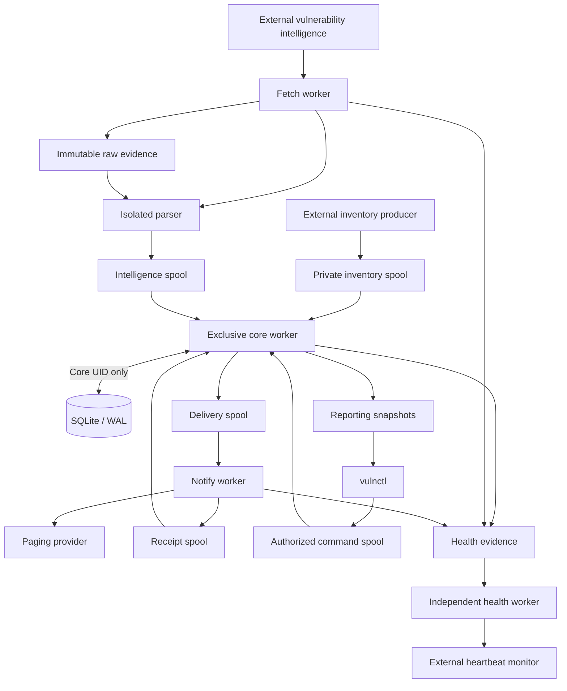

# vulnmon

**Vulnerability intelligence and correlation engine**

Vulnmon is a Python-first project for continuously correlating an organization's observed software inventory with external vulnerability intelligence. Its purpose is to identify applicable or potentially applicable vulnerabilities, prioritize them using explicit policy, maintain evidence-backed findings and deliver actionable notifications.

> Deterministic core. Extensible periphery. Probabilistic intelligence.

## Project status

**Architecture v0.3 — revised draft for human engineering, security and operational approval.** An offline fixture-driven core prototype exists against architecture v0.2. The implementation has not yet been reconciled with v0.3; live monitoring, paging and operational acceptance are not implemented or established.

See [ARCHITECTURE.md](ARCHITECTURE.md) for the proposed architecture, revision history, permanent correctness guarantees, release boundaries, threat model, review traceability and approval gates. See [DEVELOPMENT.md](DEVELOPMENT.md) for the existing prototype and its limitations.

## Design goals

- Lean, modular, UNIX-inspired Python components with explicit, versioned contracts.
- Short-lived commands, systemd timers and optional path activation; resident daemons and IPC only when justified.
- Deterministic, provenance-aware applicability and priority decisions; unknown never means unaffected.
- Durable ingestion, atomic inventory activation, bounded emergency-aware processing and transactional notification events.
- Distinct applicability, fix availability, remediation and delivery states; evidence-backed verification and replay.
- Separate trust boundaries for external acquisition, isolated parsing, authoritative state and notification delivery.
- Deterministic early warning and independently monitored operational progress.
- Headless operation; optional LLM, portal and external workflow integrations deferred from operational v0.

## Planned architecture (v0.3)

| Logical module | Responsibility |
|---|---|
| `inventoryd` / intake | Validate external inventory, coverage and producer identity |
| `inteld` / fetch and parse | Acquire intelligence, archive evidence, normalize hostile input under isolation |
| `correlatord` / correlate | Identity, applicability, fix availability, policy, lifecycle and authoritative persistence |
| `notifyd` / notify | Deliver exported jobs, retry and publish receipts without live database access |
| `watchdog` / health | Independently verify progress and deadlines; publish health heartbeat |
| `vulnctl` | Inspect exported reports and submit authorized local commands |
| `analystd`, `webui` | Optional deferred analysis and management capabilities |

The initial target is a single Ubuntu Server VM, including Proxmox-hosted guests, with distribution-provided Python, systemd, durable local filesystem spools and SQLite in WAL mode. Only the dedicated core identity opens the live database; locks are released between bounded batches. Actual deployment releases, package provenance, storage capacity and security controls require validation. Operational latency and escalation proposals remain subject to human approval.

## Initial scope

Operational v0 targets a representative real Ubuntu/PHP inventory, selected Ubuntu and Composer vulnerability intelligence, KEV, deterministic critical-component source watches, durable findings and paging, independent health monitoring, and point-in-time replay. Inventory generation remains an external responsibility, but a reference producer with an assigned owner and delivery date is an operational acceptance prerequisite.

Vulnmon is not an autonomous patching, endpoint detection or incident investigation platform. Proxmox hypervisor support, general-purpose discovery, LLM integration, portal, Jira/Confluence automation, socket servers and resident daemons are deferred.

## Developer quick start

See [DEVELOPMENT.md](DEVELOPMENT.md) for the existing fixture-based prototype and its test commands. These instructions describe the v0.2 implementation, not the planned v0.3 runtime.

## Implementation direction

1. Reconcile the existing offline prototype with v0.3: durable spool contracts, exclusive core identity, bounded work selection, reporting exports and receipt ingestion.
2. Establish the reference inventory producer and provenance-aware matching for the actual deployed software; integrate selected intelligence sources and deterministic early warning.
3. Implement reliable paging, acknowledgement and escalation, independent health monitoring and operational reporting.
4. Validate replay, crash recovery, restore and representative latency/workload targets with the responsible engineering and security teams before operational acceptance.

The detailed scope, acceptance gates and deferred capabilities are defined in the architecture. No production-readiness claim is made.

## License

See [LICENSE](LICENSE).
