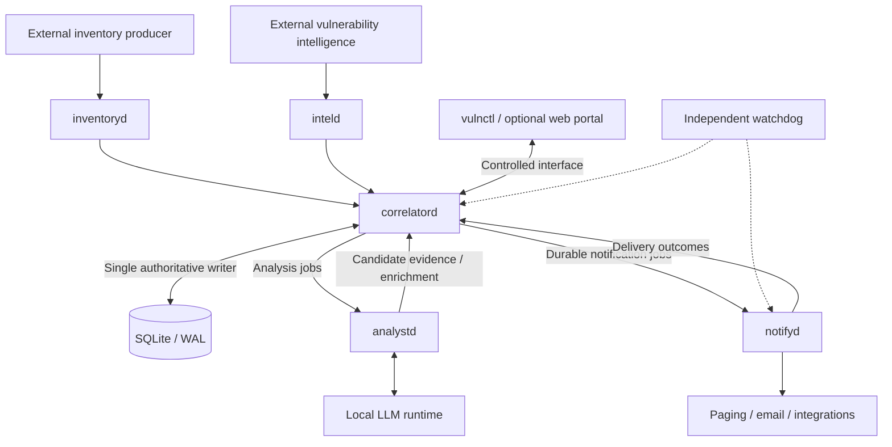

# vulnmon

**Vulnerability intelligence and correlation engine**

Vulnmon is a Python-first project for continuously correlating an organization's observed software inventory with external vulnerability intelligence. Its purpose is to identify applicable or potentially applicable vulnerabilities, prioritize them using explicit policy, maintain evidence-backed findings and deliver actionable notifications.

> Deterministic core. Extensible periphery. Probabilistic intelligence.

## Project status

**Early design stage — architecture v0.2.** The architecture is documented; the application is not yet implemented. There is no installable release or production-readiness claim.

See [ARCHITECTURE.md](ARCHITECTURE.md) for the authoritative design, revision history, component relationships, persistence requirements and implementation roadmap.

## Design goals

- Lean, modular, UNIX-inspired services with explicit, versioned interfaces.
- Python for custom application components; standard-library-first, with dependencies introduced when justified.
- Deterministic, reproducible applicability and priority decisions, including explicit handling of uncertainty.
- Continuous correlation of inventory changes and new or revised vulnerability intelligence.
- Early warning from structured feeds and unstructured advisories, including pre-CVE signals.
- Durable finding lifecycle, notification delivery, audit evidence and historical replay.
- Headless operation with a CLI and an optional, separate web portal.
- Local LLM-assisted extraction and explanation, without authority over security decisions or a dependency for the structured-intelligence emergency path.

## Planned architecture

| Component | Responsibility |
|---|---|
| `inventoryd` | Ingest, validate and normalize externally generated inventory |
| `inteld` | Acquire and normalize vulnerability intelligence; preserve source provenance |
| `correlatord` | Identity, applicability, policy, finding lifecycle and authoritative persistence |
| `notifyd` | Notification routing, delivery, retry, acknowledgement and escalation |
| `analystd` | Optional local LLM orchestration for unstructured intelligence and explanatory analysis |
| `watchdog` | Independent progress and monitoring health checks |
| `vulnctl` | Command-line query, inspection and management |
| `webui` | Optional separate reporting and management application |

The initial target is Ubuntu Server, including guests hosted on Proxmox. The proposed deployment is a single Ubuntu VM using systemd, local IPC, JSON/NDJSON contracts and SQLite in WAL mode. The core owns all authoritative writes, uses bounded priority-aware transactions, and activates complete inventory generations atomically. Database capacity and storage latency remain subject to representative benchmarking.

## Scope

Vulnmon consumes inventory supplied by an external producer. Inventory generation, discovery tooling and collection transport are separate prerequisites, not part of the initial application. The project is not an autonomous patching system, endpoint detection product or incident investigation platform.

## Implementation roadmap

1. Define versioned data contracts and durable storage; ingest synthetic inventory and advisory fixtures.
2. Implement Ubuntu-aware matching, deterministic policy evaluation and finding lifecycle.
3. Add continuous intelligence acquisition, durable notifications and independent health monitoring.
4. Integrate local LLM-assisted extraction and analysis.
5. Complete management tooling, optional web portal and further integrations.

The first milestone is a headless prototype capable of ingesting fixtures, correlating records and inspecting reproducible findings. No inventory generator, LLM or web portal is required for this milestone.

## License

See [LICENSE](LICENSE).
